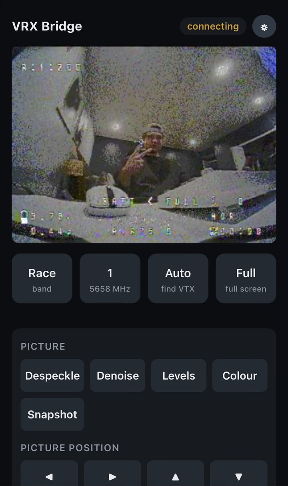
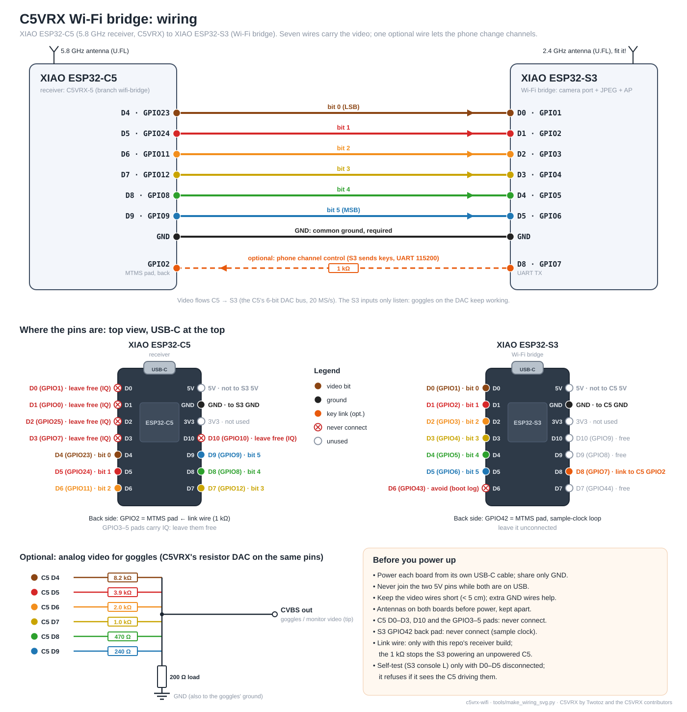
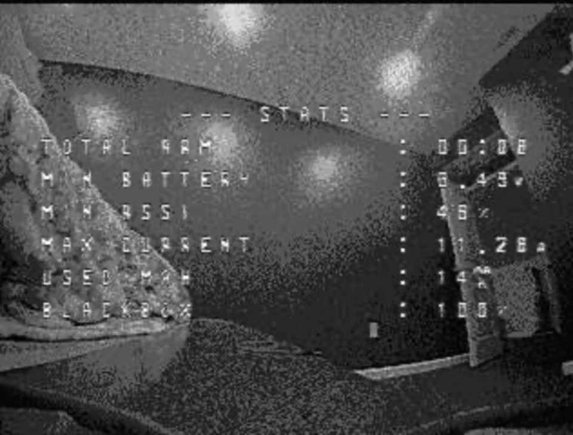

# ESP-VRX

Wi-Fi video for the [C5VRX](https://github.com/Twotoz/C5VRX) analog 5.8 GHz
FPV receiver: an ESP32-S3 reads the receiver's video output, locks to the
picture and streams it to a phone browser (or a PC over USB):



```
VTX ))) XIAO ESP32-C5 (C5VRX-5)   --video bits 1..5 on D5..D9--+--> resistor DAC --> goggles (optional)
                                                                 |
                                                                 +--> XIAO ESP32-S3 camera port
                                                                      --> sync lock --> 320x240 colour/gray
                                                                      --> JPEG --> Wi-Fi AP --> phone
        C5 D4 <-- band/channel/scan/menu keys (UART, the bit 0 wire) -- S3 D0 <-- phone buttons
```

> **All credit for the receiver goes to [C5VRX](https://github.com/Twotoz/C5VRX)
> by Twotoz and the C5VRX contributors.** This project incorporates the
> C5VRX-5 receiver firmware in `receiver/` (release `c5vrx5-v5.0.109`
> unmodified, plus three small commits: a UART key reader for the bridge,
> direct channel selection, and the key line on D4; see
> [receiver/UPSTREAM.md](receiver/UPSTREAM.md)) and builds on its documented
> video DAC output.
> Visit the [official C5VRX website](https://twotoz.github.io/C5VRX/) for the
> original project and its Discord invite. See the source and license notices
> for the applicable terms. ESP-VRX is an independent add-on: it is not an
> official C5VRX release and is not affiliated with or endorsed by C5VRX.

## Why I made this

Hey, my name is Ethan. I'm a mechanical engineer, and after watching Joshua
Bardwell's video on the C5VRX I thought I'd build my own. ESP-VRX sends
the receiver's picture over Wi-Fi to whatever device you want, a phone,
tablet or laptop, where you watch it live in the browser with nothing to
install. It's perfect for showing your family and friends your flying
without spending the big money on a proper FPV monitor.

## Layout

```
receiver/   C5VRX c5vrx5-v5.0.109 + the bridge's key reader: firmware for the XIAO ESP32-C5
bridge/     ESP-IDF project for the XIAO ESP32-S3 (capture, decoder, JPEG, Wi-Fi)
  main/video.c        composite decoder: line PLL, vertical sync, levels, 320 px lines
  main/testpattern.c  synthetic interlaced NTSC/PAL source (bars, ramp, moving box)
  main/capture.c      S3 camera port + DMA ring, loopback self-test
  main/denoise.c      temporal denoise (encoder side)
  main/mbox.c         frame mailbox between the decoder and the encoder (and screen)
  main/stream.c       Wi-Fi access point, web page, MJPEG stream
  main/display.c      optional SPI TFT screen (ILI9341 / ST7789)
  main/console.c      USB console keys
  main/c5link.c       receiver keys to the C5 over a UART wire
  main/web/index.html the phone page
  test/               host test of the decoder (runs on the PC, no hardware)
tools/      build.ps1 (build/flash/monitor), bridge_tool.py (status, captures, self-test),
            mock_bridge.py (the page with a test stream, no hardware)
```

## Wiring (7 wires)



Generated by `tools/make_wiring_svg.py` (edit its pin tables and rerun).

| XIAO ESP32-C5 | video bit | XIAO ESP32-S3 |
| --- | --- | --- |
| D4 (GPIO23) | receiver keys, S3 to C5 (was bit 0) | D0 (GPIO1) |
| D5 (GPIO24) | 1 | D1 (GPIO2) |
| D6 (GPIO11) | 2 | D2 (GPIO3) |
| D7 (GPIO12) | 3 | D3 (GPIO4) |
| D8 (GPIO8) | 4 | D4 (GPIO5) |
| D9 (GPIO9) | 5 (MSB) | D5 (GPIO6) |
| GND | ground | GND |

- **The bit 0 wire carries the receiver keys** (band, channel, scan, menu)
  from the phone: the receiver (this repo's `receiver/` build, branch
  `wifi-bridge`) listens on D4 instead of outputting video bit 0, and the S3
  sends on D0, so no extra wire and no soldering on the back are needed. The
  video arrives with 5 bits; a real recording replayed at 5 bits locked the
  same and looked nearly the same (the C5's output used 22 of the 64 levels,
  16 remain). The S3 drives the line only while it sends a key (about half a
  millisecond, from a 2 ms idle high before the frame) and releases it in
  between, so it never feeds an unpowered C5. `u` on the S3 console checks
  the wire: "receiver pull-up seen" means the receiver is listening. The S3
  only drives the line when it finds it idling high (the receiver's
  pull-up); otherwise no key is sent, so it never fights a C5 that still
  outputs video on D4 or feeds an unpowered one. Flash the receiver first,
  then the S3.
- Alternative with full 6-bit video: a separate wire from S3 D8 (GPIO7)
  through 1 kΩ to the C5's GPIO2, the MTMS pad on the back (menuconfig
  `BRIDGE_KEYS_ON_D0` off, `BRIDGE_KEYS_ON_D4 0` in `receiver/main/receiver.h`).
  GPIO2 is a strapping pin but selects nothing that matters at boot (SDIO
  edges only).
- **Never connect C5 D0..D3 or D10.** C5VRX drives them with the raw radio
  data of its internal IQ loopback.
- **Leave the S3's GPIO42 pad (MTMS, back side) unconnected.** It carries
  the camera-port sample clock out and back in.
- Keep the wires under ~5 cm; they switch at up to 40 MHz. More than one
  ground wire helps.
- On the bench, power each board from its own USB-C cable and share only
  ground. Do not tie the two 5V pins while both are on USB (the S3's 5V
  pin is an output). Power the S3 first (or both together): a powered C5
  drives its six video outputs into an unpowered S3. If the C5 ever stays
  silent (no `HB` lines on its console, bus stuck at one code), press its
  RESET button with both boards on.
- Powering the C5 from the S3's 5V pin (5V to 5V, only the S3 on USB) needs
  a short, good cable straight into the PC: on a weak cable the C5 never got
  running and the S3 reset when the C5 was connected. Connect the wire with
  everything unplugged; 100-470 µF across the C5's 5V/GND helps.
- The optional C5VRX resistor DAC (8.2k/3.9k/2k/1k/470R/240R + 200R, see
  [their README](https://github.com/Twotoz/C5VRX#wiring-the-resistor-dac))
  can stay on the same pins for goggles; the S3 inputs do not load it. With
  the keys on D4 leave out the DAC's D4 resistor (8.2k): bit 0 is not
  output anyway, and the resistor would pull the key line low.
- Keep the S3's 2.4 GHz antenna away from the C5's 5.8 GHz antenna.

## Optional: a wired screen (4 more wires)

The picture can also go to a 320×240 SPI TFT wired to the S3, with no Wi-Fi
in between; the phone stream keeps working at the same time. Made for the
common red 2.8"/3.2" ILI9341 board; ST7789 IPS modules (240×320) work too.
It is off by default: `.\tools\build.ps1 bridge -Menuconfig`, then
*ESP-VRX* > *SPI TFT screen* on and pick the controller, build and flash.

| Screen pin | XIAO ESP32-S3 |
| --- | --- |
| VCC | 3V3 |
| GND | GND |
| CS | D9 (GPIO8) |
| RESET | 3V3 (the S3 resets the panel by command) |
| DC (RS) | D7 (GPIO44) |
| SDI (MOSI) | D10 (GPIO9) |
| SCK | D8 (GPIO7) |
| LED (backlight) | 3V3 |
| SDO (MISO) | not connected |
| T_CLK, T_CS, T_DIN, T_DO, T_IRQ (touch) | not connected |

ST7789 modules label them SCL (SCK), SDA (MOSI), RES (RESET) and BLK (LED).
D7..D10 are the S3's only free pads: D0..D5 carry the video and keys, D6
(GPIO43) the boot log, and the GPIO42 pad the sample clock. The pins can be
changed in menuconfig; the build stops with an error if one lands on the
video, the key wire, GPIO42 or GPIO43. With the separate key wire
(`BRIDGE_KEYS_ON_D0` off) D8 is taken by the keys: move one of the two.

Menuconfig also has the SPI clock (40 MHz: a whole frame in 31 ms, just
enough for 30 fps; lower it with long wires), colour inversion (on for most
ST7789 IPS modules), 180° rotation and mirroring. The console's `s` line
then shows `lcd_fps` next to the stream's `fps`. Without line and field lock
a `NO SIGNAL` badge covers the top left of the picture; without any frames
(capture stopped) the screen turns black with the badge.

Limits:

- **No touch**: the S3 has no pins left for the touch controller.
- **TFTs wash out in sunlight**, the red TN boards most (narrow viewing
  angle too); an IPS module is better at an angle, neither is readable in
  direct sun. Shade it, or use goggles.
- Grayscale only, like the stream, and without the denoise (that runs in
  the JPEG encoder; the screen gets the decoder's frames directly).
- PAL fields (288 lines) are shown with every 6th line left out.
- No tearing sync (the boards bring out no TE pin): a fast pan can show a
  tear line.
- The backlight is always on.
- Enabling the screen adds Espressif's ILI9341 driver
  (`espressif/esp_lcd_ili9341`) to the build and to `dependencies.lock`; a
  `-Reconfigure` prints `Missing kconfig option. Re-run the build process`
  once, as the component manager reads the settings in a second pass.
- First version: it builds for both controllers but has not run with a
  screen wired yet.

## Toolchain

- ESP-IDF **6.0.2** (`build.ps1` uses `C:\esp\v6.0.2\esp-idf` unless `IDF_PATH` is set).
  C5VRX needs exactly this version: its build checks the C5 `libphy.a` hash
  (`dbf33c41...`, verified) and disables filter/DC correction otherwise.
- A project venv `.venv` with pyserial, numpy, matplotlib and ziglang (a C
  compiler for the host test).
- Clone to a path without spaces or apostrophes (ESP-IDF does not accept
  them), e.g. `C:\dev\esp-vrx`.

On a new PC: clone ESP-IDF v6.0.2 with submodules, run
`install.ps1 esp32c5,esp32s3`, clone this repo, create the
venv with `pip install pyserial numpy matplotlib ziglang`.

## Build, flash, monitor

Windows blocks `.ps1` scripts by default; run them through a one-off bypass
(changes no system setting):

```powershell
powershell -ExecutionPolicy Bypass -File .\tools\build.ps1 bridge -Port COMx -Flash
```

Inside a PowerShell window that already allows scripts the short form works:

```powershell
.\tools\build.ps1                                   # both firmwares
.\tools\build.ps1 bridge -Port COMx -Flash -Monitor # S3; Ctrl+] leaves the monitor
.\tools\build.ps1 receiver -Port COMy -Flash        # C5 (flash it before the S3)
.\tools\build.ps1 bridge -Reconfigure               # after editing Kconfig.projbuild
.\tools\build.ps1 bridge -Menuconfig                # Wi-Fi name/password, pins, fps, quality
.\.venv\Scripts\python bridge\test\run_host_tests.py  # decoder test on the PC
```

`.\.venv\Scripts\python tools\bridge_tool.py ports` lists the serial ports
(both XIAOs show up as Espressif `303a:1001`).

The C5 can also run the official prebuilt firmware from the
[web flasher](https://twotoz.github.io/C5VRX/) (tab C5VRX-5): the picture
works, but the phone's receiver buttons do not (it has no key reader and
outputs all 6 bits on D4..D9; the S3 then sends no keys). `build.ps1
receiver -Flash` flashes this repo's build of the same release with the key
reader.

## First test: the S3 alone

1. Plug in the XIAO ESP32-S3 (with its antenna), then
   `.\tools\build.ps1 bridge -Port COMx -Flash -Monitor`.
2. Self-test of the camera port, **with nothing connected to D0..D5**:
   press `L` then `y` in the monitor (or `bridge_tool.py selftest`). It drives
   the video pins from the S3 itself and checks every bit and the sample
   rate: every pattern `:ok`, then `rate=20.00MS/s(want 20) PASS` (with the
   keys on D0, bit 0 is not tested).
3. Test patterns through the real decoder and JPEG encoder (console `t`):
   NTSC locked, 262/263 lines per field, 30 fps, 0 overruns; PAL 312/313
   lines, 25 fps.
4. On the phone, join Wi-Fi **ESP-VRX** (password `vrxbridge`), open
   `http://192.168.4.1/`, open the gear (Settings) and tap **Test pattern**
   until the badge says `TEST NTSC`: bars, a ramp and a box moving left and
   right. That proves Wi-Fi and the page end to end (`s` on the console then
   shows `stations=1 clients=1`).

**Fit the S3's antenna.** The XIAO ESP32-S3 ships its 2.4 GHz antenna loose
in the bag; without it on the U.FL connector an iPhone did not see the
network at all, and a nearby PC joined at −77..−85 dBm with dropped page
loads and repeated reconnects. On iPhone, iOS shows "No Internet Connection"
under the network name; that is expected, Safari still opens
`http://192.168.4.1`. The console logs every join, leave and page request
(`WIFI ...`, `HTTP ...`); `w` lists joined devices with their signal.

## With the C5

1. Antenna on the C5 first (never run a radio without one). Flash the
   receiver: `.\tools\build.ps1 receiver -Port COMy -Flash -Monitor`.
2. First boot with the **VTX off**: C5VRX calibrates for up to two
   minutes. Then VTX on; in the C5 monitor press `T` for status (sync, AFC
   lock, C/N) and `s` to scan. It starts on A1 (5865 MHz); the BOOT button
   steps channels (short press) or opens the menu (hold 0.6 s).
3. Unplug both, wire the 7 wires, plug both back in.
4. Phone page: the badge shows `LIVE NTSC`/`LIVE PAL` when line and field
   sync are locked (Settings > Test pattern cycles back to the C5 input).
   Pick your VTX's band and channel, or tap **Auto**.
5. If the picture is off: `bridge_tool.py raw` saves the raw bus samples and
   a plot (`captures/raw_*.png`): the waveform should show sync pulses at the
   bottom every 63.6 us; the stacked-lines image shows a straight dark band.

Notes from the first board: a VTX at full power 1-2 m away overloaded the
C5 (picture lost); lower power or a few metres fixed it. The C5's sync tip
and blanking are only ~5 DAC codes apart (white ~17 codes above blanking),
which shaped the decoder's sync detection (see below).

## On the phone

Join **ESP-VRX** (password `vrxbridge`), open `http://192.168.4.1/` (or
`http://esp-vrx.local/`) and tap **Full**: on iPhone the picture opens in
the phone's own video player, like a YouTube video (Done or a swipe down
leaves it); desktop, Android and iPad use the browser's full screen.



The page reads the MJPEG stream itself and draws only the newest frame, so
the picture never falls behind (Safari's own handling of an MJPEG ``
stuttered); the frames drawn on a canvas play in a `<video>`, which is what
the native player needs. The overlay's fps is what this device really shows.
`tools/mock_bridge.py` serves the page with a test stream for working on it
without hardware.

The bridge only runs its own network, on a fixed channel. An earlier
version could also join a home network; while it searched for one, the
bridge's network kept moving channel (12 and 13, which iPhones barely use)
and paused for every search, and the phone's picture stuttered. That option
is gone; the first boot of this version erases a home network it stored.

## Controls

Web page: the picture and four buttons. **Band** and **Channel** open a
picker (Raceband R, Boscam A/B/E, Fatshark F, Lowband L; channels 1-8 with
their frequencies) and tune the receiver straight there; **Auto** scans all
48 channels and tunes to the strongest VTX; **Full** shows the picture full
screen (on iPhone in the native video player). The receiver does not report
back, so the pickers show the channel last set from the page ("auto" after a
scan). Everything else is under the gear (Settings): Despeckle (median filter
against FM clicks; off = `[1 2 1]` smoothing), Denoise (averages still areas
over frames), Levels (auto contrast / standard levels), Colour (NTSC colour
from the colour burst, or gray: colour runs at ~21 fps, gray at 30), Snapshot, picture
position (0.2 us / 1 line), the receiver's own menu (Menu, Next, Select,
Close, Video std), the test pattern and the details (lock, standard, levels,
sample rate, decode load, fps, frame size, memory, uptime, last start).

The receiver keys travel as C5VRX's own console keys (`c b s o n x e v`) in
`<k>` frames, and a picked channel as `<#NN>` (0..47, band × 8 + channel),
over the bit 0 wire. C5VRX draws its menu, channel and scan results into the
video, so they show up in the stream. Only these keys are accepted by the
receiver; the download and calibration keys cannot be sent from the phone.

USB console (S3): `s` status, `t` source, `c` levels, `j`/`l` left/right,
`i`/`k` up/down, `f` despeckle, `d` denoise, `w` Wi-Fi details (devices, signal, and per viewer the
frames per second that actually went out, skipped frames and send time), `R` raw dump, `F` JPEG frame, `L` self-test, `G` capture
diagnostics (clock pad, DMA, registers, restart variants), `C` followed by
a receiver key (e.g. `Cc` next channel), `#NN` tune straight to channel NN (`#00` = Raceband 1), `u` check the key line and the wire to the C5, `h` help.

**Live video over USB** (no Wi-Fi needed): `.\.venv\Scripts\python tools\bridge_tool.py live`
and open `http://127.0.0.1:8090/`. The console's `V`/`v` turn on a binary
JPEG stream with a CRC per frame (about 11 fps at 28 KB per frame; the base64
`F` dump manages about 1 fps). The S3 stops it by itself when the PC stops
reading. The page has Despeckle/Denoise buttons and the lock status; the COM
port is busy while it runs.

The status line includes the decoder's health: `overruns` must stay 0;
`fps` is the JPEG encoder's rate (and `lcd_fps` the wired screen's, if built in);
`load` is the share of core 1 used; `pass_max`, `gap_max` and `line_max`
are the longest decode pass, wait and single line of the last 0.5 s (`kind`:
1 drawn, 2 field start, 4 sync search). `reset=` says why the S3 last started
(`usb`, `power-on`, `brownout`, `crash`, `watchdog`, ...).

## How the bridge works

- **Capture**: the S3 LCD_CAM camera receiver samples D0..D5 at 20 MHz
  (menuconfig: 10 MHz) with its own clock routed out and back through
  GPIO42; DE/HSYNC are tied high in the GPIO matrix, so every clock is a
  sample. GDMA writes a 64 KiB ring in internal SRAM (3.3 ms at 20 MHz); each
  2 KiB node ends with an EOF whose interrupt advances the write position and
  wakes the decoder. No CPU per sample.
  Board findings: recording starts on a rising VSYNC edge (VSYNC is tied
  low during setup, then high), and that edge must come a few microseconds
  after `cam_start`, or a restart records nothing; every start therefore
  resets and reconfigures LCD_CAM and waits 20 us before the edge.
  The C5 holds each of its 20 MS/s samples for 50 ns (two 40 MHz clocks);
  the S3 samples asynchronously, so an occasional sample taken during a
  transition is wrong, and the despeckle filter removes it with the FM clicks.
- **Decoder** (core 1, `video.c`): slicer between sync tip and blanking,
  sync edges interpolated to 1/256 sample, a line PLL with flywheel
  (±2 us search when locked), broad-pulse vertical sync, NTSC/PAL from lines
  per field, levels from the sync tip and the back porch after the colour
  burst, and 320 pixels per line through either a median of three samples 2
  apart (*despeckle*, default) or a `[1 2 1]` low-pass with taps 0.1 us apart
  (−15 dB at the NTSC colour subcarrier at 10 and 20 MS/s).
  Sync detection works on the signal averaged over 0.4 us: on the C5 the
  sync tip is only ~6 codes below blanking with ~3 codes of noise per
  sample, so single samples chopped every sync and the line lock dropped
  ~50 times a second (board recording, replayed with `bridge/test/replay.py`).
  Vertical sync needs at least 5 of 7 probes (6..24 us into the line) below
  the slicer, and once locked a new field is only accepted within 8 lines of
  the expected 262/312. A missed vertical sync (a fade, a channel change) is
  replaced after the expected length without losing the line count
  (interlaced 262/263 kept), and the next real one is taken (lock dropped
  after 4 fields without one). If the decoder falls a ring behind while
  locked, it skips whole lines and keeps both locks. With the C5's small
  sync amplitude, two probes took dark picture for vertical sync and split
  frames; a measured low-run length was cut short by single FM clicks. One field
  becomes one frame: 320×240 NTSC, 320×288 PAL. Without sync it free-runs,
  like an analog monitor. Only fields that will be encoded are drawn (every
  other field at 30 fps), pixels go through a per-field level LUT (in the
  pixel loop, except on the histogram lines), and the
  project builds with `-O2`: at ESP-IDF's default `-Og` one drawn line took
  longer than a line of video lasts.
  **Colour** (NTSC, on by default, `m` on the console or the page's Colour
  button; [docs/colour-study.md](docs/colour-study.md)): the colour burst of
  every other line is measured against the subcarrier at the absolute sample
  index and averaged into a phase and amplitude reference; a burst more than
  35° off is used for its own line only, and a second one off to the same
  side restarts the average (a clock slip: the S3 samples the C5's 20 MS/s
  with its own clock and takes a sample twice or drops one every few tens of
  ms, a 64° step). On the even rows the chroma is summed over 64 blocks of
  16 samples with the S3's SIMD instructions (checked against C at start,
  `colour=on(no-simd)` in `s` if not) and rotated by the reference into a
  Cb/Cr plane next to the unchanged luma rows: the decoder writes no more to
  PSRAM than for gray. Board, live: 62 µs per drawn line (gray 50), 61 % of
  core 1, no overruns. PAL and pictures without a burst stay gray.
- **Stream** (core 0): the decoder hands frames over through three buffers
  (four with the screen, `mbox.c`), newest wins, so the encoder always
  starts on the latest picture and the decoder never waits. Optional temporal denoise (a pixel within ±28 of the
  running picture is averaged into it, a bigger change is taken as motion),
  then grayscale JPEG (`esp_new_jpeg`, quality 60) at up to 30 fps, always the
  same field parity; colour frames are encoded 4:2:0 from YCbYCr built 16
  rows at a time in internal RAM (block encoder, no colour frame in PSRAM),
  denoised on the way, ~21 fps with denoise (the encoder's ms per frame:
  `enc_ms=` denoise + colour bands + JPEG in `s`; a noisy picture makes the
  JPEG itself slower); MJPEG on port 81 (up to 3 viewers: when all are taken
  the oldest makes room, and a viewer that reads nothing for 5 s is closed),
  page and status on port 80. The page closes its stream while it is in the
  background and reconnects after 5 s without data. 2.4 GHz only: 5 GHz Wi-Fi would land on the FPV band. The denoise
  runs here and not in the decoder: at 20 MHz the decoder's extra PSRAM
  traffic caused 47 overruns/s.
- **Screen** (optional, core 0, `display.c`): its own task takes the newest
  finished frame from the same mailbox as the encoder, so neither waits for
  the other, and the decoder never renders into a frame being read. Gray goes
  to RGB565 through a table, 12 lines at a time into two 7.5 KB internal
  DMA buffers: one is converted while the other goes out over SPI (esp_lcd,
  DMA). The whole screen is one window per frame (the first strip starts
  it, the others continue it), and the frame goes back to the mailbox as
  soon as its last strip is converted. Converting should cost core 0 about
  2 ms a frame (estimated); the rest is the SPI DMA.
- **Host test** (`run_host_tests.py`): NTSC/PAL test patterns at 10 and 20 MHz
  with noise, FM clicks and C5-like weak, noisy levels, also with 5 bits
  (keys on the bit 0 wire), through the real decoder (lock, field length and
  count, no lock losses, no rolled field after 1-3 missed vertical syncs, the
  lock kept through a short stall), and the frame mailbox in random
  orders of hand-offs (the decoder never gets a frame a reader holds; with
  one reader exactly the frames of the original three-buffer mailbox).
  `bridge_tool.py rawlong` records ~6 real fields from the board and
  `replay.py` runs them through the decoder with lock/field events.
  With clicks: speckles smooth 64 / despeckle 0; noise (rms) smooth 11.5,
  despeckle 7.4, despeckle + denoise 4.3.

Expect a delay on the order of 100 ms (one field, JPEG, Wi-Fi, browser;
not measured yet): fine for watching and recording, use the analog output
for flying.

## Troubleshooting

| Symptom | Check |
| --- | --- |
| Network not visible / keeps dropping | Antenna on the S3's U.FL connector? `w` on the console shows each device's signal (better than −70 dBm is good). |
| `CAPTURE FAULT` | Monitor log: `camera port records nothing`. Run the self-test without the C5. |
| C5 silent on USB, or the raw bus stuck at one code | The C5 is not running: press its RESET with both boards powered. Check that the S3 runs this repo's build (key link released between keys). |
| `NO SIGNAL` with the C5 wired | C5 status `T` shows video? Ground wire? `bridge_tool.py raw`: all zeros = wiring; noise around code 25 with no sync pulses = no VTX received (VTX off or flat, wrong channel: **Scan**). The C5's menu only shows over a received picture. |
| Picture lost with the VTX close by | The C5 is overloaded: lower the VTX power or move it a few metres away. |
| Picture rolls or tears | Weak signal: sync is lost. Raw plot shows whether sync pulses reach the bottom. |
| Picture shifted | Arrow buttons; offsets are not stored across reboots yet. |
| Banded / scrambled picture | Two data wires swapped: bit order D4->D0 ... D9->D5. |
| Too dark / washed out | Levels button: *auto* stretches the picture, *std* uses the sync amplitude. |
| Reception worse with the S3 on | Move the antennas apart, lower `BRIDGE_WIFI_TX_POWER_DBM` (default 13 dBm). |
| `overruns` climbing in `s` | The decoder falls behind: check `load`, `line_us drawn` (above ~70 us the 3.3 ms ring runs out during a drawn field; colour live is ~62, gray ~50), `line_max` (single long lines are fine) and that `bridge\sdkconfig` has `CONFIG_COMPILER_OPTIMIZATION_PERF=y`. Colour off (`m`) frees ~12 us per drawn line. |
| No colour, or colour flickers | `s`: `colour=no-burst` means no colour burst is seen (PAL, a black-and-white camera, or a weak picture: `burst` below 0.5 codes turns colour off, above 0.8 on). `slips` counts the S3/C5 clock slips and `clock` the clock offset they give (~2 ppm on the bench pair). |
| Several pictures stacked in one frame | False vertical syncs: `lines/field` in `s` should be 262 (NTSC) or 312/313 (PAL). |
| Picture on the phone stutters | `w` while it plays: `VIEWER` fps well below the `fps` in `s`, or long `send_ms`, means frames do not get out fast enough. Open `http://192.168.4.1/bench` on the phone: the console's `BENCH` line gives the Wi-Fi link's own speed (1 MB of filler). Fast there but slow video: the browser; slow there too: the link (signal, interference). Keep the phone on ESP-VRX: iOS leaves networks without internet (turn off Auto-Join of the home network while watching). |
| Receiver buttons do nothing | `u` on the S3 console: it must PASS and report "receiver pull-up seen (line rose in a few us)". Anything else means the receiver is not listening, and the S3 sends no keys: check the D4-D0 wire, that the C5 runs this repo's `receiver/` build (flash it first, then the S3), and that no DAC resistor sits on D4. The C5 console prints `BRIDGE key c` / `BRIDGE channel N` for each key it gets; a channel picked during its start-up calibration is applied when it ends. |
| `.ps1 cannot be loaded` | Use the `powershell -ExecutionPolicy Bypass -File ...` form above. |

## Next experiments

- Colour: decode the 3.58/4.43 MHz subcarrier (20 MHz sampling is now the default).
- Show the C5's channel on the page: a return wire, or read C5VRX's `STATUS` beat.
- Lower latency: WebSocket frames, smaller JPEG, or raw 160×120. Encode the
  JPEG in strips while the field is still being decoded (now a whole frame
  waits for its last line). On a slow link a frame can wait behind the
  previous one in the 32 KB TCP send buffer: measure whether a smaller
  buffer lowers the delay without costing frames.
- Denoise: a soft blend near the motion threshold instead of a hard switch.
- Capture: an interrupt held off for more than a ring (3.3 ms) would make the
  write position skip a whole ring unnoticed; read the DMA's own descriptor
  position instead of counting EOF interrupts.
- A per-unit network name and password (from the MAC) instead of the shared
  default.
- DVR to the PC: `bridge_tool.py frame` or record the MJPEG stream.

## Credits

- **[C5VRX](https://github.com/Twotoz/C5VRX)** by Twotoz and the C5VRX
  contributors: the ESP32-C5 receiver this project is built around, its
  firmware (`receiver/`), its 6-bit video DAC output that the bridge reads,
  and its resistor DAC for goggles. Project website:
  <https://twotoz.github.io/C5VRX/>.
- [ESP-IDF](https://github.com/espressif/esp-idf),
  [esp_new_jpeg](https://components.espressif.com/components/espressif/esp_new_jpeg)
  and [mdns](https://components.espressif.com/components/espressif/mdns) by
  Espressif Systems (their own licenses).
- The camera-port capture started by a VSYNC edge follows the approach of
  [ok-home/logic_analyzer](https://github.com/ok-home/logic_analyzer).

## License

- `bridge/`, `tools/`, `docs/` and this README: `GPL-3.0-only`, the same
  license as C5VRX (see [LICENSE](LICENSE)).
- `receiver/` is C5VRX, `GPL-3.0-only`; see its LICENSE and
  [UPSTREAM.md](receiver/UPSTREAM.md) (what differs from the release).
- The C5VRX name and logo are not covered by the GPL
  ([branding terms](https://github.com/Twotoz/C5VRX/blob/main/assets/BRANDING.md)):
  this project uses the name only to refer to the receiver it works with.
