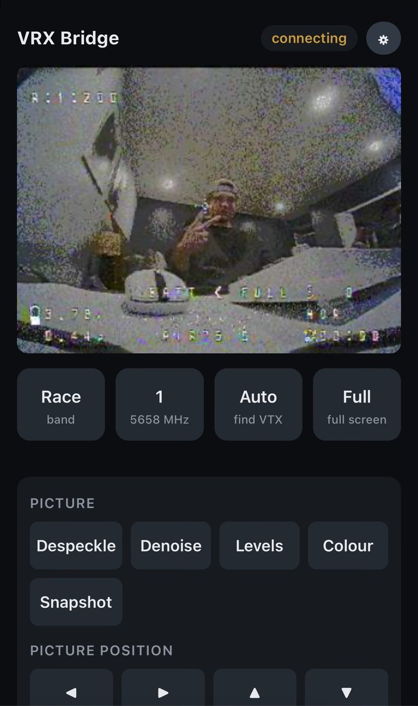
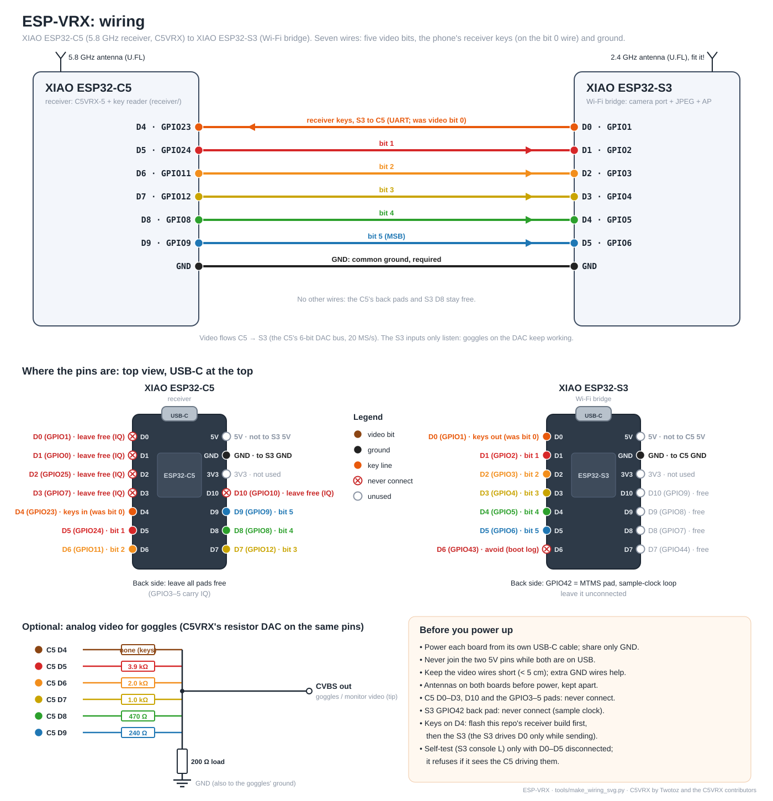
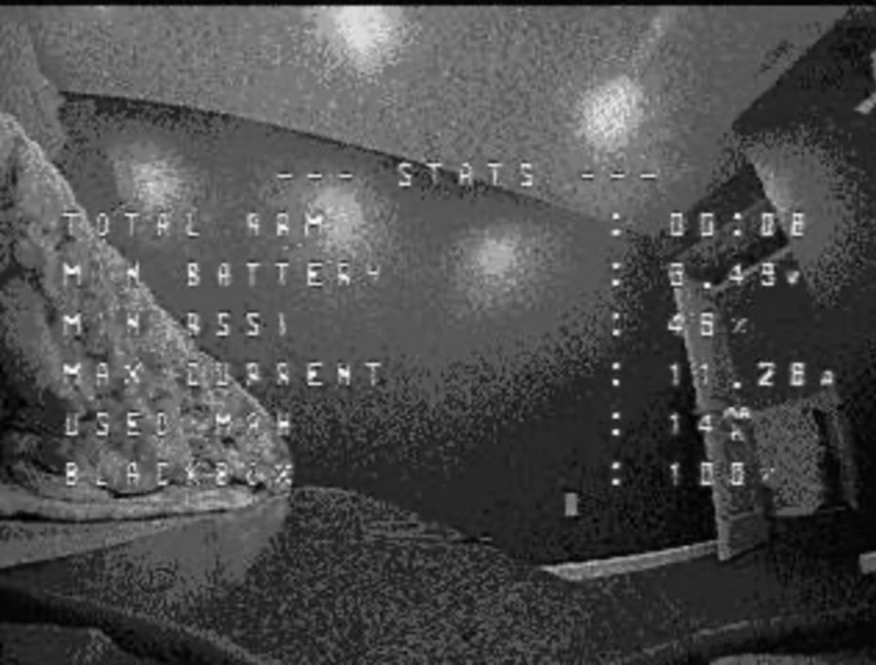

# ESP-VRX

Wi-Fi video for the [C5VRX](https://github.com/Twotoz/C5VRX) analog 5.8 GHz
FPV receiver: an ESP32-S3 reads the receiver's video output, locks to the
picture and streams it to a phone browser (or a PC over USB):



```
VTX ))) XIAO ESP32-C5 (C5VRX-5)   --video bits 1..5 on D5..D9--+--> resistor DAC --> goggles (optional)
                                                                 |
                                                                 +--> XIAO ESP32-S3 camera port
                                                                      --> sync lock --> 320x240 colour/gray
                                                                      --> JPEG --> Wi-Fi AP --> phone
        C5 D4 <-- band/channel/scan/menu keys (UART, the bit 0 wire) -- S3 D0 <-- phone buttons
```

> **All credit for the receiver goes to [C5VRX](https://github.com/Twotoz/C5VRX)
> by Twotoz and the C5VRX contributors.** This project incorporates the
> C5VRX-5 receiver firmware in `receiver/` (release `c5vrx5-v5.0.109`
> unmodified, plus three small commits: a UART key reader for the bridge,
> direct channel selection, and the key line on D4; see
> [receiver/UPSTREAM.md](receiver/UPSTREAM.md)) and builds on its documented
> video DAC output.
> Visit the [official C5VRX website](https://twotoz.github.io/C5VRX/) for the
> original project and its Discord invite. See the source and license notices
> for the applicable terms. ESP-VRX is an independent add-on: it is not an
> official C5VRX release and is not affiliated with or endorsed by C5VRX.

## Why I made this

Hey, my name is Ethan. I'm a mechanical engineer, and after watching Joshua
Bardwell's video on the C5VRX I thought I'd build my own. ESP-VRX sends
the receiver's picture over Wi-Fi to whatever device you want, a phone,
tablet or laptop, where you watch it live in the browser with nothing to
install. It's perfect for showing your family and friends your flying
without spending the big money on a proper FPV monitor.

## What it does

- **Live picture in any browser**: join the bridge's own Wi-Fi and open one
  page. Nothing to install; up to three viewers at once.
- **Colour** for NTSC (from the colour burst, fading to gray on a weak
  signal), gray for PAL. 320×240 (NTSC) or 320×288 (PAL), up to 30 frames a
  second in gray and about 21 in colour.
- **Band, Channel and Auto on the phone**: tune the receiver straight to a
  channel or let it find the strongest VTX. No extra wire: the keys travel
  on one of the video wires.
- **Full screen like a video app**, on iPhone in the native player.
- **Remembers your picture settings** (position, levels, despeckle, denoise,
  colour) across power cycles.
- **Live view over USB** on a PC, without Wi-Fi.
- **Optional wired screen**: a 320×240 SPI TFT on four more wires.

It is for watching, showing and recording, not for flying: expect a delay
on the order of 100 ms. Fly on the analog output.

## What you need

| Part | Notes |
| --- | --- |
| Seeed XIAO ESP32-C5 with a 5.8 GHz antenna | the receiver; never power it without the antenna |
| Seeed XIAO ESP32-S3 with its 2.4 GHz antenna | the bridge; the antenna ships loose in the bag and must be fitted |
| 7 short wires (under 5 cm) | 6 signal wires and ground |
| 2 USB-C data cables | one per board on the bench; charge-only cables show no serial port |
| A PC with ESP-IDF 6.0.2 | to build and flash both boards (Windows scripts included) |
| An analog 5.8 GHz VTX with a camera | the thing to watch |

## Wiring (7 wires)



Generated by `tools/make_wiring_svg.py` (edit its pin tables and rerun).

| XIAO ESP32-C5 | video bit | XIAO ESP32-S3 |
| --- | --- | --- |
| D4 (GPIO23) | receiver keys, S3 to C5 (was bit 0) | D0 (GPIO1) |
| D5 (GPIO24) | 1 | D1 (GPIO2) |
| D6 (GPIO11) | 2 | D2 (GPIO3) |
| D7 (GPIO12) | 3 | D3 (GPIO4) |
| D8 (GPIO8) | 4 | D4 (GPIO5) |
| D9 (GPIO9) | 5 (MSB) | D5 (GPIO6) |
| GND | ground | GND |

- **The bit 0 wire carries the receiver keys** (band, channel, scan, menu)
  from the phone: the receiver (this repo's `receiver/` build) listens on D4
  instead of outputting video bit 0, and the S3
  sends on D0, so no extra wire and no soldering on the back are needed. The
  video arrives with 5 bits; a real recording replayed at 5 bits locked the
  same and looked nearly the same (the C5's output used 22 of the 64 levels,
  16 remain). The S3 drives the line only while it sends a key (about half a
  millisecond, from a 2 ms idle high before the frame) and releases it in
  between, so it never feeds an unpowered C5. `u` on the S3 console checks
  the wire: "receiver pull-up seen" means the receiver is listening. The S3
  only drives the line when it finds it idling high (the receiver's
  pull-up); otherwise no key is sent, so it never fights a C5 that still
  outputs video on D4 or feeds an unpowered one. Flash the receiver first,
  then the S3.
- Alternative with full 6-bit video: a separate wire from S3 D8 (GPIO7)
  through 1 kΩ to the C5's GPIO2, the MTMS pad on the back (menuconfig
  `BRIDGE_KEYS_ON_D0` off, `BRIDGE_KEYS_ON_D4 0` in `receiver/main/receiver.h`).
  GPIO2 is a strapping pin but selects nothing that matters at boot (SDIO
  edges only).
- **Never connect C5 D0..D3 or D10.** C5VRX drives them with the raw radio
  data of its internal IQ loopback.
- **Leave the S3's GPIO42 pad (MTMS, back side) unconnected.** It carries
  the camera-port sample clock out and back in.
- Keep the wires under ~5 cm; they switch at up to 40 MHz. More than one
  ground wire helps.
- On the bench, power each board from its own USB-C cable and share only
  ground. Do not tie the two 5V pins while both are on USB (the S3's 5V
  pin is an output). Power the S3 first (or both together): a powered C5
  drives its six video outputs into an unpowered S3. If the C5 ever stays
  silent (no `HB` lines on its console, bus stuck at one code), press its
  RESET button with both boards on.
- Powering the C5 from the S3's 5V pin (5V to 5V, only the S3 on USB) needs
  a short, good cable straight into the PC: on a weak cable the C5 never got
  running and the S3 reset when the C5 was connected. Connect the wire with
  everything unplugged; 100-470 µF across the C5's 5V/GND helps.
- The optional C5VRX resistor DAC (8.2k/3.9k/2k/1k/470R/240R + 200R, see
  [their README](https://github.com/Twotoz/C5VRX#wiring-the-resistor-dac))
  can stay on the same pins for goggles; the S3 inputs do not load it. With
  the keys on D4 leave out the DAC's D4 resistor (8.2k): bit 0 is not
  output anyway, and the resistor would pull the key line low.
- Keep the S3's 2.4 GHz antenna away from the C5's 5.8 GHz antenna.

## Optional: a wired screen (4 more wires)

The picture can also go to a 320×240 SPI TFT wired to the S3, with no Wi-Fi
in between; the phone stream keeps working at the same time. Made for the
common red 2.8"/3.2" ILI9341 board; ST7789 IPS modules (240×320) work too.
It is off by default: `.\tools\build.ps1 bridge -Menuconfig`, then
*ESP-VRX* > *SPI TFT screen* on and pick the controller, build and flash.

| Screen pin | XIAO ESP32-S3 |
| --- | --- |
| VCC | 3V3 |
| GND | GND |
| CS | D9 (GPIO8) |
| RESET | 3V3 (the S3 resets the panel by command) |
| DC (RS) | D7 (GPIO44) |
| SDI (MOSI) | D10 (GPIO9) |
| SCK | D8 (GPIO7) |
| LED (backlight) | 3V3 |
| SDO (MISO) | not connected |
| T_CLK, T_CS, T_DIN, T_DO, T_IRQ (touch) | not connected |

ST7789 modules label them SCL (SCK), SDA (MOSI), RES (RESET) and BLK (LED).
D7..D10 are the S3's only free pads: D0..D5 carry the video and keys, D6
(GPIO43) the boot log, and the GPIO42 pad the sample clock. The pins can be
changed in menuconfig; the build stops with an error if one lands on the
video, the key wire, GPIO42 or GPIO43. With the separate key wire
(`BRIDGE_KEYS_ON_D0` off) D8 is taken by the keys: move one of the two.

Menuconfig also has the SPI clock (40 MHz: a whole frame in 31 ms, just
enough for 30 fps; lower it with long wires), colour inversion (on for most
ST7789 IPS modules), 180° rotation and mirroring. The console's `s` line
then shows `lcd_fps` next to the stream's `fps`. Without line and field lock
a `NO SIGNAL` badge covers the top left of the picture; without any frames
(capture stopped) the screen turns black with the badge.

Limits:

- **Not yet run with a screen wired**: it builds for both controllers and its
  frame hand-off is covered by the host test, but orientation, colours and
  frame rate on a real panel are unchecked.
- **No touch**: the S3 has no pins left for the touch controller.
- **TFTs wash out in sunlight**, the red TN boards most (narrow viewing
  angle too); an IPS module is better at an angle, neither is readable in
  direct sun. Shade it, or use goggles.
- Colour like the stream, but without the denoise (that runs in the JPEG
  encoder; the screen gets the decoder's frames directly).
- PAL fields (288 lines) are shown with every 6th line left out.
- No tearing sync (the boards bring out no TE pin): a fast pan can show a
  tear line.
- The backlight is always on.
- Enabling the screen adds Espressif's ILI9341 driver
  (`espressif/esp_lcd_ili9341`) to the build and to `dependencies.lock`; a
  `-Reconfigure` prints `Missing kconfig option. Re-run the build process`
  once, as the component manager reads the settings in a second pass.

## Toolchain

- ESP-IDF **6.0.2** (`build.ps1` uses `C:\esp\v6.0.2\esp-idf` unless `IDF_PATH` is set).
  C5VRX needs exactly this version: its build checks the C5 `libphy.a` hash
  (`dbf33c41...`, verified) and disables filter/DC correction otherwise.
- A project venv `.venv` with the packages in
  [`tools/requirements.txt`](tools/requirements.txt) (pyserial, numpy,
  matplotlib, pillow, and ziglang as the C compiler for the host test).
- Clone to a path without spaces or apostrophes (ESP-IDF does not accept
  them), e.g. `C:\dev\esp-vrx`.

On a new PC: clone ESP-IDF v6.0.2 with submodules, run
`install.ps1 esp32c5,esp32s3`, clone this repo, then
`python -m venv .venv` and `.venv\Scripts\pip install -r tools\requirements.txt`.

## Build, flash, monitor

Windows blocks `.ps1` scripts by default; run them through a one-off bypass
(changes no system setting):

```powershell
powershell -ExecutionPolicy Bypass -File .\tools\build.ps1 bridge -Port COMx -Flash
```

Inside a PowerShell window that already allows scripts the short form works:

```powershell
.\tools\build.ps1                                   # both firmwares
.\tools\build.ps1 bridge -Port COMx -Flash -Monitor # S3; Ctrl+] leaves the monitor
.\tools\build.ps1 receiver -Port COMy -Flash        # C5 (flash it before the S3)
.\tools\build.ps1 bridge -Reconfigure               # after editing Kconfig.projbuild
.\tools\build.ps1 bridge -Menuconfig                # Wi-Fi name/password, pins, fps, quality
.\.venv\Scripts\python bridge\test\run_host_tests.py  # decoder test on the PC
```

`.\.venv\Scripts\python tools\bridge_tool.py ports` lists the serial ports
(both XIAOs show up as Espressif `303a:1001`).

On Linux and macOS there is no script: with ESP-IDF 6.0.2 exported, run
`idf.py -C bridge build flash monitor` and `idf.py -C receiver build flash`
(add `-p PORT` with both boards plugged in).

**Change the Wi-Fi password** before using it away from the bench
(`-Menuconfig` > *ESP-VRX*): the default is printed in this README, so anyone
nearby could watch and change channels.

The C5 can also run the official prebuilt firmware from the
[web flasher](https://twotoz.github.io/C5VRX/) (tab C5VRX-5): the picture
works, but the phone's receiver buttons do not (it has no key reader and
outputs all 6 bits on D4..D9; the S3 then sends no keys). `build.ps1
receiver -Flash` flashes this repo's build of the same release with the key
reader.

## First test: the S3 alone

1. Plug in the XIAO ESP32-S3 (with its antenna), then
   `.\tools\build.ps1 bridge -Port COMx -Flash -Monitor`.
2. Self-test of the camera port, **with nothing connected to D0..D5**:
   press `L` then `y` in the monitor (or `bridge_tool.py selftest`). It drives
   the video pins from the S3 itself and checks every bit and the sample
   rate: every pattern `:ok`, then `rate=20.00MS/s(want 20) PASS` (with the
   keys on D0, bit 0 is not tested).
3. Test patterns through the real decoder and JPEG encoder (console `t`):
   NTSC colour bars locked, 262/263 lines per field, 0 overruns; PAL 312/313
   lines, 25 fps.
4. On the phone, join Wi-Fi **ESP-VRX** (password `vrxbridge`), open
   `http://192.168.4.1/`, open the gear (Settings) and tap **Test pattern**
   until the badge says `TEST NTSC`: bars, a ramp and a box moving left and
   right. That proves Wi-Fi and the page end to end (`s` on the console then
   shows `stations=1 clients=1`).

**Fit the S3's antenna.** The XIAO ESP32-S3 ships its 2.4 GHz antenna loose
in the bag; without it on the U.FL connector an iPhone did not see the
network at all, and a nearby PC joined at −77..−85 dBm with dropped page
loads and repeated reconnects. On iPhone, iOS shows "No Internet Connection"
under the network name; that is expected, Safari still opens
`http://192.168.4.1`. The console logs every join, leave and page request
(`WIFI ...`, `HTTP ...`); `w` lists joined devices with their signal.

## With the C5

1. Antenna on the C5 first (never run a radio without one). Flash the
   receiver: `.\tools\build.ps1 receiver -Port COMy -Flash -Monitor`. If the
   port does not answer, unplug it and plug it back in while holding BOOT.
2. First boot with the **VTX off**: C5VRX calibrates for up to two
   minutes. Then VTX on; in the C5 monitor press `T` for status (sync, AFC
   lock, C/N) and `s` to scan. The BOOT button steps channels (short press)
   or opens the menu (hold 0.6 s).
3. Unplug both, wire the 7 wires, plug both back in.
4. Phone page: the badge shows `LIVE NTSC`/`LIVE PAL` when line and field
   sync are locked (Settings > Test pattern cycles back to the C5 input).
   Pick your VTX's band and channel, or tap **Auto**.
5. If the picture is off: `bridge_tool.py raw` saves the raw bus samples and
   a plot (`captures/raw_*.png`): the waveform should show sync pulses at the
   bottom every 63.6 us; the stacked-lines image shows a straight dark band.

Notes from the first board: a VTX at full power 1-2 m away overloaded the
C5 (picture lost); lower power or a few metres fixed it. The C5's sync tip
and blanking are only ~5 DAC codes apart (white ~17 codes above blanking),
which shaped the decoder's sync detection.

## On the phone

Join **ESP-VRX** (password `vrxbridge`), open `http://192.168.4.1/` (or
`http://esp-vrx.local/`) and tap **Full**: on iPhone the picture opens in
the phone's own video player, like a YouTube video (Done or a swipe down
leaves it); desktop, Android and iPad use the browser's full screen.
*Add to Home Screen* gives it its own icon and opens it without the
browser's bars.



The page reads the MJPEG stream itself and draws only the newest frame, so
the picture never falls behind (Safari's own handling of an MJPEG ``
stuttered); the frames drawn on a canvas play in a `<video>`, which is what
the native player needs. The overlay's fps is what this device really shows.
If no frame arrives for 2.5 s the last one is dimmed under "No video
arriving" (a frozen picture would otherwise look live), and the page
reconnects by itself; the badge says `offline` when the bridge stops
answering.

The bridge only runs its own network, on a fixed channel (2.4 GHz: 5 GHz
Wi-Fi would land on the FPV band).

## Controls

Web page: the picture and four buttons. **Band** and **Channel** open a
picker (Raceband R, Boscam A/B/E, Fatshark F, Lowband L; channels 1-8 with
their frequencies) and tune the receiver straight there; **Auto** scans all
48 channels and tunes to the strongest VTX; **Full** shows the picture full
screen (on iPhone in the native video player). The receiver does not report
back, so the pickers show the channel last set from the page ("auto" after a
scan). Everything else is under the gear (Settings):

- **Picture**: Despeckle (median filter against FM clicks; off = `[1 2 1]`
  smoothing), Denoise (averages still areas over frames), Levels (auto
  contrast / standard levels), Colour (NTSC colour from the colour burst, or
  gray: colour runs at ~21 fps, gray at 30).
- **Picture position**: 0.2 us / 1 line per tap.
- **Receiver menu**: the receiver's own menu (Menu, Next, Select, Close,
  Video std).
- **Tools**: Snapshot, Test pattern, and Defaults.
- **Details**: firmware version, lock, standard, levels, colour, sample
  rate, decode load, fps, frame size, the delay inside the bridge, memory,
  uptime, last start.

**The bridge remembers the picture settings and position** across power
cycles (written to its flash 2 s after the last change). **Defaults**, or
`z` on the console, puts them back.

The receiver keys travel as C5VRX's own console keys (`c b s o n x e v`) in
`<k>` frames, and a picked channel as `<#NN>` (0..47, band × 8 + channel),
over the bit 0 wire. C5VRX draws its menu, channel and scan results into the
video, so they show up in the stream. Only these keys are accepted by the
receiver; the download and calibration keys cannot be sent from the phone.

USB console (S3, any serial terminal or `bridge_tool.py keys`): `s` status,
`t` source, `c` levels, `j`/`l` left/right, `i`/`k` up/down, `f` despeckle,
`d` denoise, `m` colour, `z` picture settings back to defaults, `w` Wi-Fi
details (devices, signal, per viewer the frames per second that actually went
out, skipped frames and send time, and what the page server is doing), `R`
raw dump, `F` JPEG frame, `L` self-test, `G` capture diagnostics (clock pad,
DMA, registers, restart variants), `C` followed by a receiver key (e.g. `Cc`
next channel), `#NN` tune straight to channel NN (`#00` = Raceband 1), `u`
check the key line and the wire to the C5, `V`/`v` USB video on/off, `W` a
long raw recording, `h` help.

```powershell
.\.venv\Scripts\python tools\bridge_tool.py status        # one status line
.\.venv\Scripts\python tools\bridge_tool.py keys u        # check the key wire
.\.venv\Scripts\python tools\bridge_tool.py keys "#00"    # tune to Raceband 1
.\.venv\Scripts\python tools\bridge_tool.py keys w        # Wi-Fi devices and viewers
```

**Live video over USB** (no Wi-Fi needed): `.\.venv\Scripts\python tools\bridge_tool.py live`
and open `http://127.0.0.1:8090/`. The console's `V`/`v` turn on a binary
JPEG stream with a CRC per frame (about 11 fps at 28 KB per frame; the base64
`F` dump manages about 1 fps). The S3 stops it by itself when the PC stops
reading. The page has Despeckle, Denoise and Colour buttons and the lock
status; the COM port is busy while it runs.

The status line includes the decoder's health: `fw` is the firmware version;
`overruns` must stay 0 with a picture (lines lost because the decoder fell
behind; `catchups` are the same while it searches for sync, with nothing to
lose, and do rise during a receiver scan);
`fps` is the JPEG encoder's rate (and `lcd_fps` the wired screen's, if built in);
`pipe_ms` is the time from a frame's last decoded line to its JPEG being
ready; `load` is the share of core 1 used; `pass_max`, `gap_max` and
`line_max` are the longest decode pass, wait and single line of the last
0.5 s (`kind`: 1 drawn, 2 field start, 4 sync search). `reset=` says why the
S3 last started (`usb`, `power-on`, `brownout`, `crash`, `watchdog`, ...).

## How it works

In one paragraph: the S3's camera port samples the C5's video bits at
20 MS/s into a ring in memory; a decoder on its own CPU core finds the line
and field syncs, builds one frame per field and, for NTSC, decodes the
colour; the newest frame goes through a small mailbox to a JPEG encoder on
the other core, and each viewer gets the newest JPEG over Wi-Fi.

- **[docs/logic-map.md](docs/logic-map.md)**: the map of it all. Every
  stage with what it does, what must always hold, how it fails and
  recovers, and where to look; the state machines; what guards the shared
  data; the time budget; and the review that walked the map through the
  code.
- **[docs/how-it-works.md](docs/how-it-works.md)**: the reasons behind the
  design and what the boards showed along the way.
- **[docs/colour-study.md](docs/colour-study.md)**: how colour comes out of
  a 5-bit bus sampled by a drifting clock.

## Troubleshooting

| Symptom | Check |
| --- | --- |
| Network not visible / keeps dropping | Antenna on the S3's U.FL connector? `w` on the console shows each device's signal (better than −70 dBm is good). |
| No serial port for a board | A charge-only USB cable shows no port: use a data cable. Both boards show up as Espressif `303a:1001` (`bridge_tool.py ports`). |
| Badge says `offline`, or "No video arriving" | The phone lost the bridge: still on the ESP-VRX network (iOS leaves networks without internet), in range, S3 powered? The page reconnects by itself. `w` on the console shows whether the page server is still being asked (`last ... s ago`) or is stuck (`BUSY`). |
| `CAPTURE FAULT` | Monitor log: `camera port records nothing`. The bridge retries every 2 s. Run the self-test without the C5. |
| C5 silent on USB, or the raw bus stuck at one code | The C5 is not running: press its RESET with both boards powered. Check that the S3 runs this repo's build (key link released between keys). |
| `NO SIGNAL` with the C5 wired | C5 status `T` shows video? Ground wire? `bridge_tool.py raw`: all zeros = wiring; noise around code 25 with no sync pulses = no VTX received (VTX off or flat, wrong channel: **Auto**). The C5's menu only shows over a received picture. |
| Picture lost with the VTX close by | The C5 is overloaded: lower the VTX power or move it a few metres away. |
| Picture rolls or tears | Weak signal: sync is lost. Raw plot shows whether sync pulses reach the bottom. |
| Picture shifted | Settings > Picture position; the bridge remembers it. **Defaults** puts everything back. |
| Banded / scrambled picture | Two data wires swapped: bit order D4->D0 ... D9->D5. |
| Too dark / washed out | Levels button: *auto* stretches the picture, *std* uses the sync amplitude. |
| Reception worse with the S3 on | Move the antennas apart, lower `BRIDGE_WIFI_TX_POWER_DBM` (default 13 dBm). |
| `overruns` climbing in `s` | The decoder falls behind with a picture: check `load`, `line_us drawn` (above ~70 us the 3.3 ms ring runs out during a drawn field; colour live is ~62, gray ~50), `line_max` (single long lines are fine) and that `bridge\sdkconfig` has `CONFIG_COMPILER_OPTIMIZATION_PERF=y`. Colour off (`m`) frees ~12 us per drawn line. `catchups` alone are harmless. |
| No colour, or colour flickers | `s`: `colour=no-burst` means no colour burst is seen (PAL, a black-and-white camera, or a weak picture: `burst` below 0.5 codes turns colour off, above 0.8 on). `colour=noisy` means a burst but too much noise for colour (`bnoise` 30° or more; `sat` below 1.00 is colour faded by noise from 15°). `slips` counts the S3/C5 clock slips and `clock` the clock offset they give (~2 ppm on the bench pair). |
| Several pictures stacked in one frame | False vertical syncs: `lines/field` in `s` should be 262 (NTSC) or 312/313 (PAL). |
| Picture on the phone stutters | `w` while it plays: `VIEWER` fps well below the `fps` in `s`, or long `send_ms`, means frames do not get out fast enough. Open `http://192.168.4.1/bench` on the phone: the console's `BENCH` line gives the Wi-Fi link's own speed (1 MB of filler). Fast there but slow video: the browser; slow there too: the link (signal, interference). Keep the phone on ESP-VRX: iOS leaves networks without internet (turn off Auto-Join of the home network while watching). |
| Receiver buttons do nothing | `u` on the S3 console: it must PASS and report "receiver pull-up seen (line rose in a few us)". Anything else means the receiver is not listening, and the S3 sends no keys (the page then says so): check the D4-D0 wire, that the C5 runs this repo's `receiver/` build (flash it first, then the S3), and that no DAC resistor sits on D4. The C5 console prints `BRIDGE key c` / `BRIDGE channel N` for each key it gets; a channel picked during its start-up calibration is applied when it ends. |
| `.ps1 cannot be loaded` | Use the `powershell -ExecutionPolicy Bypass -File ...` form above. |

## Project layout

```
receiver/   C5VRX c5vrx5-v5.0.109 + the bridge's key reader: firmware for the XIAO ESP32-C5
bridge/     ESP-IDF project for the XIAO ESP32-S3 (version in version.txt)
  main/capture.c      S3 camera port + DMA ring, loopback self-test
  main/video.c        composite decoder: line PLL, vertical sync, levels, pixels, NTSC colour
  main/chroma_pie.S   the colour sums with the S3's SIMD instructions
  main/mbox.c         frame mailbox between the decoder and the encoder (and screen)
  main/stream.c       Wi-Fi access point, JPEG encoder, web page, MJPEG stream
  main/denoise.c      temporal denoise (encoder side)
  main/display.c      optional SPI TFT screen (ILI9341 / ST7789)
  main/c5link.c       receiver keys to the C5 over a UART wire
  main/settings.c     picture settings stored across power cycles
  main/console.c      USB console keys
  main/testpattern.c  synthetic interlaced NTSC/PAL source (colour bars, ramp, moving box)
  main/web/           the phone page and its icon
  test/               host tests of the decoder, mailbox and counters (run on the PC)
tools/      build.ps1 (build/flash/monitor), bridge_tool.py (status, captures, keys, USB live view),
            mock_bridge.py (the page with a test stream, no hardware), check_consistency.py,
            make_wiring_svg.py, make_icon.py, chroma_study.py
docs/       logic-map.md, how-it-works.md, colour-study.md, the wiring diagram
```

## Development

```powershell
.\.venv\Scripts\python bridge\test\run_host_tests.py   # decoder, colour, mailbox, counters + consistency
.\.venv\Scripts\python tools\mock_bridge.py            # the page at http://127.0.0.1:8091/ without hardware
.\.venv\Scripts\python tools\bridge_tool.py rawlong    # record ~6 real fields from the board ...
.\.venv\Scripts\python bridge\test\replay.py captures\rawlong_*.bin   # ... and replay them through the decoder
```

- The host tests run the real decoder on synthetic NTSC/PAL with noise, FM
  clicks, weak C5-like levels, 5 bits, missed vertical syncs, stalls, colour
  bars with clock slips and colour-band noise, plus the frame mailbox and
  the capture counter. `check_consistency.py` then checks that the firmware,
  the page and the mock agree on status fields, commands and keys.
- `mock_bridge.py --freeze-after 8 --status-hang 14 --no-receiver` shows how
  the page copes with a frozen stream, a bridge that stops answering and a
  receiver that is not listening.
- Every push builds both firmwares and runs the host tests on GitHub
  (`.github/workflows/ci.yml`).
- Start from [docs/logic-map.md](docs/logic-map.md): a change should keep
  the rules of the stage it touches, and add its findings to the review
  table. Changes are listed in [CHANGELOG.md](CHANGELOG.md).

## Roadmap

Open questions and ideas, roughly by value:

- Measure the whole delay from camera to eye (film a stopwatch through it).
  The bridge's own share is in `pipe_ms`.
- Record the bus during a receiver scan: the sync search falls behind then
  (`catchups`), and it is not known why.
- Run the SPI screen on a real panel.
- Show the C5's channel on the page: a return wire, or read C5VRX's `STATUS` beat.
- Lower latency: WebSocket frames, smaller JPEG, or raw 160×120. Encode the
  JPEG in strips while the field is still being decoded (now a whole frame
  waits for its last line). On a slow link a frame can wait behind the
  previous one in the 32 KB TCP send buffer: measure whether a smaller
  buffer lowers the delay without costing frames.
- A per-unit network name and password (from the MAC) instead of the shared
  default; a way to change them from the page.
- Flashing from the browser and firmware updates over Wi-Fi, so no
  toolchain is needed.
- PAL colour (4.43 MHz, alternating phase).
- Denoise: a soft blend near the motion threshold instead of a hard switch.
- DVR to the PC: `bridge_tool.py frame` or record the MJPEG stream.

## Credits

- **[C5VRX](https://github.com/Twotoz/C5VRX)** by Twotoz and the C5VRX
  contributors: the ESP32-C5 receiver this project is built around, its
  firmware (`receiver/`), its 6-bit video DAC output that the bridge reads,
  and its resistor DAC for goggles. Project website:
  <https://twotoz.github.io/C5VRX/>.
- [ESP-IDF](https://github.com/espressif/esp-idf),
  [esp_new_jpeg](https://components.espressif.com/components/espressif/esp_new_jpeg)
  and [mdns](https://components.espressif.com/components/espressif/mdns) by
  Espressif Systems (their own licenses).
- The camera-port capture started by a VSYNC edge follows the approach of
  [ok-home/logic_analyzer](https://github.com/ok-home/logic_analyzer).

## License

- `bridge/`, `tools/`, `docs/` and this README: `GPL-3.0-only`, the same
  license as C5VRX (see [LICENSE](LICENSE)).
- `receiver/` is C5VRX, `GPL-3.0-only`; see its LICENSE and
  [UPSTREAM.md](receiver/UPSTREAM.md) (what differs from the release).
- The C5VRX name and logo are not covered by the GPL
  ([branding terms](https://github.com/Twotoz/C5VRX/blob/main/assets/BRANDING.md)):
  this project uses the name only to refer to the receiver it works with.
