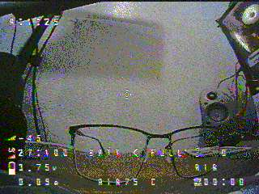
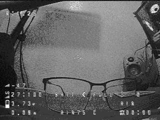
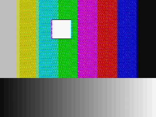
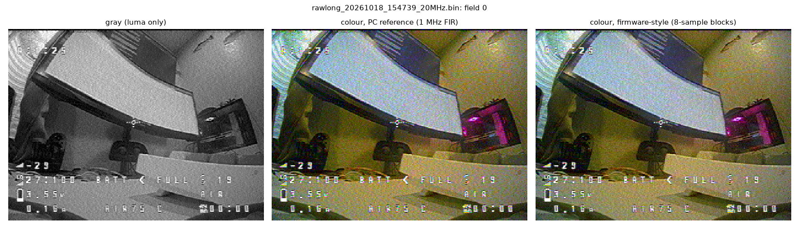
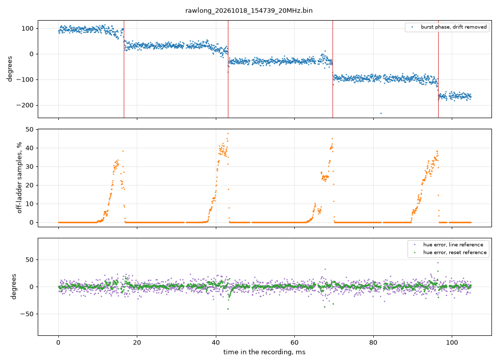

# Colour study: NTSC colour from the C5VRX video bus

Can ESP-VRX show colour, and what would it cost? This started as a
PC-only study on raw recordings of the bus between the C5 and the S3, with
the prototype [`tools/chroma_study.py`](../tools/chroma_study.py); every
number in the sections after "On the board" comes from it unless a source is
named. The firmware has since been built and measured on the board: see the
next section.

## On the board (2026-10-20)

Colour runs on the bridge: NTSC fields with a colour burst come out in
colour, at ~21 fps live (gray: 30), with no decoder overruns. The `m` key
and the page's Colour button switch back to gray.

| Live, same indoor scene, bench pair | colour | gray |
| --- | --- | --- |
| decoder time per line in drawn fields (a line lasts 63.6 µs) | 62.3 µs | 50.3 µs |
| ... in fields that are not drawn | 23.0 µs | 20.7 µs |
| core 1 load (`s`) | 61 % | 59 % |
| overruns | 0 | 0 |
| JPEG frames per second | ~21 | 30 |
| JPEG size (q60) | ~18 KB | ~15 KB |
| burst level | 2.1-2.3 codes | |

| Live colour (board) | Live gray (same firmware, seconds later) | Test pattern, 75 % bars (board) |
| --- | --- | --- |
|  |  |  |

What it took, against the plan below:

- **The instruction counts were 2-3x low.** The first build (YCbYCr written
  by the decoder, chroma in plain C at 80 blocks a line) needed 106 µs per
  drawn line on the test pattern and overran. Measured with the cycle
  counter, per drawn line: chroma sums 9,400 cycles, Cb/Cr interpolation and
  packing 5,300, the 640-byte row to PSRAM 4,200 (PSRAM writes stall on
  cache-line fills, worse while core 0 moves frames), luma 8,300.
- **What made it fit.** Chroma sums with the S3's SIMD
  (`bridge/main/chroma_pie.S`, 16 multiply-adds per instruction, checked
  against the C version at start); chroma only on the even rows (JPEG 4:2:0
  halves vertical chroma anyway) and over 64 blocks of 16 samples; the frame
  as luma rows plus a small Cb/Cr plane, so the decoder writes no more to
  PSRAM than for gray; the burst of every other line only; the level LUT
  folded into the pixel loop (gray profits too: 61.6 µs per drawn line live
  before these changes, 50.3 after).
- **Core 0** builds YCbYCr 16 rows at a time in internal RAM for
  esp_new_jpeg's block encoder (no colour frame in PSRAM). Colour JPEG,
  denoise of both planes and the band conversion hold it to ~21 fps.
- **Slips.** The detector counts more steps than the clock offset implies
  (live: ~60 a second against ~37 at 1.9 ppm), in up/down pairs from noise,
  so the signed sum and the `clock` reading (+1-2 ppm) stay right. A second
  far-off burst now has to be off to the same side as the first.
- **The test pattern** has 75 % colour bars with a burst. Its per-phase lines
  sit in internal RAM, and it writes at most 3/4 of the ring per pass: one
  pass for all the time since a long one overran the ring (also in gray).

Not done: colour at 30 fps (core 0 bound), PAL colour, a check of hue
against a known colour target in front of the camera.

## Answer

Yes. The C5 passes the NTSC colour burst and the picture's chroma through its
FM tracker. A decoder on the PC gets a recognisable colour picture out of a
recorded bus, from 6 bits and from 5 bits alike. Clock slips are real but
rare on this pair of boards. A burst average that restarts on a phase step
hides almost all of them. The hard part is CPU time on the S3. The chroma
mixing loop fits next to today's decoder only with the S3's SIMD
instructions (PIE). In plain C it would take about a third of core 1 on its
own.



| Question | Measured (6-bit recording) | Verdict |
| --- | --- | --- |
| Is colour on the bus? | Burst 2.74 codes peak, about one tracker step. Picture chroma 8.7 IRE median, 19 IRE at the 95th percentile. | Yes |
| Colour noise per pixel | U/V 4.2-4.3 IRE with a 1 MHz low-pass, 3.1-3.2 IRE firmware-style (0.4 MHz). 75 % colour bars carry 31-47 IRE. | Fine on strong colours; visible speckle on weak ones |
| Clock slips | One every 26.6 ms (S3 1.9 ppm fast), each −62 to −69° of hue (one sample = 64.4°) | A slip lands inside 0.13 % of lines; 0.4 % of lines get a hue error > 20° with the restarting average |
| Bit-mixed samples | 23 % of the time, up to 45 % of a line's samples | +15 % chroma noise on those rows |
| 5 bits (keys on the bit 0 wire) | The same after a 32-entry table. Without it: −0.4 dB burst, +5 % chroma noise. | 5 bits is fine |
| S3 decoder (core 1) | +14 % average load with PIE (130 chroma samples per line), +31 % in plain C. Today: 60-66 %. | PIE needed |
| JPEG (core 0) | 4:2:0 colour frame 1.14× the gray size. Espressif's figure: 22 ms per 320×240 4:2:0 frame. | Estimate: +7 ms per frame |

## Inputs

- `captures/rawlong_20261018_154739_20MHz.bin`: 2 MiB, 104.9 ms, about 6
  fields, recorded with `bridge_tool.py rawlong`. An indoor scene (desk,
  monitor) with the Betaflight OSD.
- `captures/rawlong_5bit_20MHz.bin` is the same recording with bit 0
  cleared. Checked byte for byte: `(6-bit & 62) == 5-bit` on all 2,097,152
  samples. So the 6-bit vs 5-bit comparison sees the same signal and the
  same noise.
- Earlier result (scratch script): a burst of about 2.8 codes at 3.579545 MHz
  on the back porch, and a 5 dB chroma bump in the picture spectrum. The
  prototype confirms both.

## What the C5 puts on the bus

- **24 output levels.** Every tracker LUT in `receiver/main/kp_tables.h` only
  outputs codes on one ladder: 0, 2, 4, 7, 9, 12, 15, 17, 20, 23, 25, 28,
  30, 33, 36, 38, 41, 44, … That is one step every ~2.67 codes, about 4.6 bits.
- **Levels.** Sync tip 15.4 and blanking 21.5 codes: 6.13 codes = 40 IRE, so
  1 code = 6.5 IRE and one tracker step = 17 IRE. Sync to white spans about
  8 tracker steps.
- **Burst.** 2.74 codes peak, where 20 IRE would be 3.07 codes. The FM chain
  takes about 1 dB off at 3.58 MHz. This doesn't matter, because the decoder
  scales chroma by the burst, like a TV's automatic colour control.
- **Noise.** 1.7 codes rms per sample on clean lines, so the burst's
  per-sample SNR is 0 dB. The noise dithers the coarse steps. Averaging the
  45-sample burst window gives its phase to 8.0° per line (white noise would
  give 7.6°).
- **Bit-mixed samples.** 4.8 % of all samples are codes the tracker cannot
  produce. These are samples the S3 took while the C5's bits were changing
  (see Clock slips).
- **The `g` key.** OUTPUT 1.5/2.0/2.5x (`receiver/main/output_level.h`) maps
  each 6-bit code to one other code. The bus carries the same 24 levels,
  spread wider; nothing new reaches the S3.

## How the prototype decodes

Per line:

1. **Sync.** The same slicer on the 0.4 µs box average, sub-sample edge and
   line PLL as `bridge/main/video.c`. Fields and rows are numbered as there.
   All 1648 lines were found (no flywheel lines).
2. **Burst.** 45 samples (8.05 subcarrier cycles, so no DC leak) from 5.5 µs
   after the sync edge. The burst is taken as a complex amplitude against the
   subcarrier at the **absolute** sample index. In that frame NTSC's 180°
   line-to-line alternation disappears (227.5 cycles per line). The phase
   then only drifts slowly with the clocks, and steps at each slip.
3. **Phase reference**, three variants:
   - *line*: each line's own burst.
   - *avg*: an IIR average of the bursts (k = 1/8, about 16 lines).
   - *reset*: the average, plus a slip detector. A burst more than 35° off
     the average is used for its own line only. A second one in a row that
     agrees with it restarts the average there.
4. **Chroma.** Mix with the subcarrier, low-pass, and rotate by the reference
   (U = −Im, V = Re). The burst amplitude stands for 20 IRE.
   - *PC reference*: a 41-tap FIR, −3 dB at 0.76 MHz and −6 dB at 1.0 MHz.
     Luma = composite minus the remodulated chroma, then video.c's `[1 2 1]`.
   - *Firmware-style*: sums over 8-sample blocks (0.4 µs, 130 per line), with
     cos/sin tables made zero-mean per block so flat luma leaks nothing, then
     `[1 2 1]` across blocks: −3 dB at 0.42 MHz, about VHS colour. The blocks
     alone reach 1.1 MHz and are as noisy as the PC reference (U/V 4.3/4.2
     IRE). Luma is video.c's `[1 2 1]` smooth filter (−15 dB at the
     subcarrier) minus the chroma it lets through, computed from the blocks.
5. **Picture.** One field becomes 320×240. Luma gets auto levels (1st to
   99.5th percentile) like the bridge, and chroma gets the same gain.

## Results

### Picture

The colours are plausible: warm walls under room light, a cool-white
monitor, a magenta light on the PC. The white OSD characters get rainbow
edges (cross-colour). Luma detail near 3.58 MHz decodes as colour; every
notch or band-pass decoder does this. A comb filter would remove it, but it
needs a line of memory and is sensitive to slips. The absolute hue was not
checked: the recording has no known colour target.

### 6-bit vs 5-bit

| | 6-bit | 5-bit, ladder table | 5-bit raw |
| --- | --- | --- | --- |
| burst amplitude, codes peak | 2.74 | 2.73 | 2.61 |
| burst residual noise, clean lines, codes rms | 1.72 | 1.76 | 1.80 |
| burst phase noise per line, clean / bit-mixed lines | 8.0° / 10.1° | 7.9° / 9.5° | 8.5° / 10.1° |
| U / V noise per pixel, PC reference, IRE | 4.3 / 4.2 | 4.2 / 4.1 | 4.5 / 4.4 |
| U / V noise per pixel, firmware-style, IRE | 3.2 / 3.1 | 3.2 / 3.1 | 3.3 / 3.3 |
| luma noise per pixel, IRE | 3.7 | 3.7 | 3.5 |
| lines with hue error > 20°, reset reference | 0.38 % | 0.50 % | 0.69 % |
| JPEG q60, 4:2:0 colour / gray | 1.14 | 1.13 | 1.14 |

Pixel noise is measured frame to frame: field 0 against field 2, the same
rows, robust (MAD) so that small motion doesn't count.

No two ladder codes differ only in bit 0. So a 32-entry table maps 5-bit
codes back onto the ladder exactly, and 5 bits loses nothing except on
bit-mixed samples. Even without the table the loss is small. One thing
needs 6 bits: counting bit-mixed samples. Clearing bit 0 hides most of them
(0.9 % seen instead of 4.8 %). The slip detector that matters (burst phase
steps) works the same with 5 bits.

### Clock slips



The C5 holds each code for 50 ns. The S3 samples it with its own 20 MHz
clock, so its sample point drifts against the C5's codes:

- **Rate.** 4 slips in 104.9 ms, one every 26.6 ms = every 419 lines. Every
  step is negative (−63, −62, −67, −69°), so the S3 takes one code twice: it
  runs fast. The step equals one sample (64.4°) within the burst noise.
- **Clock offset, two ways.** From the slip interval: +1.88 ppm. From the
  line period in S3 samples (1271.1153) times the burst frequency between
  slips (measured in C5 samples): +1.74 ppm. The second method assumes the
  camera keeps fsc = 227.5 × line rate. The two agree within 0.14 ppm.
- **The slip itself.** For 6.0 ms before each slip (23 % of the time), the
  sample point sits inside the C5's bit transitions. Some bits come from the
  next code, so up to 45 % of a line's samples are bit-mixed. 6.0 ms of
  drift at 1.88 ppm is ~11 ns of the 50 ns sample. During that stretch the
  burst phase slides by 6-19°. It then jumps by the remaining 50-61° when
  the last bits slip.
- **Hue error per line** against the step-keeping median of the bursts.
  That median has ~3° of noise of its own, which is included below.

  | Reference | rms | lines > 10° | lines > 20° |
  | --- | --- | --- | --- |
  | line (own burst) | 8.3° | 16.5 % | 1.51 % |
  | avg (k = 1/8) | 5.6° | 4.6 % | 1.82 % |
  | reset (avg + slip detector) | 5.5° | 2.6 % | 0.38 % |

  The own burst is too noisy: 8° of line-to-line hue jitter. The plain
  average lags for ~7 lines after each slip. With the restart, about 2
  lines per slip are left with a visible error: the line the slip lands in
  (0.13 % of lines) plus about one more.
- **Other board pairs.** Slips per line scale with the clock offset: one
  every 1 / (offset × 1271) lines. That is 419 lines at 1.9 ppm, 79 at
  10 ppm and 39 at 20 ppm. At about 2 lines per slip, a pair 10 ppm apart
  would show a hue error on about 2.5 % of lines, and 20 ppm on about 5 %.
  This is an estimate that assumes each slip behaves as here. The offset
  also moves with temperature. The 23 % of bit-mixing time doesn't depend on
  the offset: the stretches get shorter and more frequent.
- **Cost of bit-mixing.** Rows with > 5 % bit-mixed samples have U/V noise
  4.7 IRE vs 4.1 on clean rows, and luma 4.2 vs 3.7 IRE (PC reference,
  without the despeckle median; only 12 such rows in fields 0/2). The burst
  residual on those lines is 2.56 vs 1.72 codes.

### S3 cost

Budget: one line is 63.56 µs × 240 MHz = 15,253 cycles. The decoder draws
only the fields it encodes: 240 of 262 lines in every other field, 45.8 % of
all lines. Today it uses 60-66 % of core 1 at 20 MS/s (console `s`); the
split between drawn and undrawn lines isn't logged. Instructions per drawn
line for the firmware-style colour path at 130 chroma samples per line:

| Stage | plain C | PIE | Counted as |
| --- | --- | --- | --- |
| burst + reference (every line) | 285 | 285 | 45 × (load, 2 table loads, 2 multiply-adds) + phasor and IIR in float |
| chroma demodulation, 1044 samples | 7,308 | 1,431 | C: 7 per sample (load, mask, table load, 2 multiply-adds, pointers). PIE: ~6 per 16 samples (unaligned load, 2 table loads, 2 16-lane multiply-accumulates) + 8 per block to read and clear the accumulators |
| 130 chroma blocks: `[1 2 1]`, rotate, scale | 2,340 | 2,340 | 18 per block |
| write U/V (YCbYCr 4:2:2) | 200 | 200 | 320 more bytes per line to PSRAM |
| *optional:* cancel the chroma leaked into luma | 3,840 | 3,840 | 12 per pixel |

| Chroma samples per line | plain C | PIE |
| --- | --- | --- |
| 80 | 9,570 = 63 % of a line, +29 % average | 3,293 = 22 %, +10 % average |
| 130 | 10,470 = 69 %, +31 % | 4,593 = 30 %, +14 % |
| 160 | 11,010 = 72 %, +33 % | 5,373 = 35 %, +16 % |
| luma cancellation | +25 % of a line, +11 % average | the same |

These are instruction counts, not board measurements. The LX7 runs at best
1 instruction per cycle; loops with load stalls take 1.2-1.5×.

- **Plain C does not fit.** 60-66 % + 31 % = 91-97 % average, and on drawn
  lines the extra 69 % of a line comes on top of today's drawing. Packing cos
  and sin into one 32-bit word saves a multiply: with offset tables of ±31 and
  8-sample blocks, two 16-bit sums fit in one register. That brings it to
  about 5 instructions per sample (+25 % average), still too close. Mixing
  only every other sample halves the mixing cost, at +3 dB chroma noise.
- **PIE fits on paper.** 74-80 % average at 130 chroma samples, 70-76 % at
  80. The per-block scalar work (18 per block) is then the largest part, so
  fewer chroma samples per line pay off directly.
- **Skip luma cancellation at first.** Today's gray decoder doesn't remove
  the chroma either (despeckle median, or `[1 2 1]` at −15 dB). Add it if the
  dots bother.
- **JPEG on core 0.** Pillow at q60: gray 13.6 KiB, 4:2:0 colour 15.4 KiB
  (×1.14). The bridge's gray JPEGs are 27-28 KB in the logs, so expect
  ~31-32 KB in colour, +120 KB/s at 30 fps. Speed: esp_new_jpeg 1.0.2's
  README (ESP32-S3, one core) gives 45.3 fps = 22 ms for 320×240 YCbYCr to
  4:2:0 at q60. Gray is not in that table. Scaled by 8×8 blocks (1200
  instead of 1800), gray is ~15 ms and colour adds ~7 ms per frame: ~21 % of
  core 0 at 30 fps, next to Wi-Fi. This is an estimate; time the bridge's
  own encoder before relying on it.
- **Memory.** A YCbYCr frame is 153.6 kB instead of 76.8 kB, so the three
  hand-off buffers take 461 kB of the 8 MB PSRAM. The decoder writes 640 B
  per drawn line instead of 320. Temporal denoise would also have to handle
  U/V (half size).

## What works and what doesn't

Works:

- The burst and chroma survive the C5's tracker, the 24-level ladder and the
  bus. Colour decodes at 20 MS/s, from 5 bits as well as 6.
- The burst locks hue to 8° per line on its own, and to about 5° averaged
  (that figure includes the reference median's own ~3°).
  The C5's noise dithers its coarse steps, so averaging works.
- Slips are detected by the burst alone (phase steps of ~64°). The
  restarting average limits them to about 2 lines per slip.
- Two independent measurements of the S3-C5 clock offset agree within
  0.14 ppm. The decoder could report it in `s`.

Doesn't, or not yet:

- Weak colours are noisy: 3-4 IRE of chroma noise per pixel against a
  median colour of 8.7 IRE in this indoor scene, about 2:1. Saturated colours
  (31-47 IRE for 75 % bars) get 18-24 dB.
- Cross-colour on fine luma detail, e.g. the OSD text.
- Plain C is too slow on core 1 at 20 MS/s.
- Not verified: absolute hue (no colour target), other board pairs and
  temperatures (the slip rate), the CPU and JPEG costs on the board.

## Recommended next steps

1. **20 MHz, not 40 MHz, for now.** 40 MHz sampling would give two samples
   per C5 code, 25 ns apart. With ~11 ns transitions one of them is always
   clean. The decoder could keep the clean one and count every slip exactly,
   so no hue jumps and no bit-mixed samples. Here that would only remove
   the +15 % chroma noise on the bit-mixed rows (about a fifth of them) and
   about 2 lines per slip. It would cost:
   - the 64 KiB ring would hold 1.6 ms instead of 3.3 ms, and internal RAM
     has only 96-139 kB free in the logs to grow it;
   - twice the DMA interrupts;
   - stride-2 reads everywhere;
   - an untested camera port at 40 MHz with its GPIO42 clock loop.

   Revisit only if a board pair slips much more often. In that case the
   cleaner fix is a shared clock: the C5's PARLIO TX can drive its 40 MHz
   clock onto a pin (`clk_out_gpio_num`, now −1), for example its back-side
   GPIO2 pad, which is free with the keys on D4. A wire would carry it to a
   free S3 input used as the camera clock. The S3 could then not drift, but
   this needs a receiver change and a wire.
2. **Slip detection: the restarting burst average.** No extra hardware is
   needed: about 300 instructions per line, every line. The decoder should
   log the slip count and the measured ppm in `s`. That gives each board
   pair's real slip rate before any colour work. With 6 bits, the
   bit-mixed-sample count also warns ~6 ms ahead and shows the transition
   width.
3. **C5 OUTPUT gain (`g`): leave it at 1.0x.** It remaps the same 24 levels
   one to one, so it adds no information on the bus. Higher gains spread the
   steps further apart, which shrinks the small raw 5-bit loss. But the
   S3's 32-entry table removes that loss anyway, and high gains can clip.
4. **5 bits with the keys on the bit 0 wire: keep it.** Map codes back with
   the 32-entry ladder table in the plain-C paths (one load instead of the
   `& 63`). Raw 5-bit for PIE costs only −0.4 dB burst and +5 % chroma
   noise. The 6-bit wiring (keys on the C5's GPIO2 pad) is only worth it for
   the bit-mixing diagnostics.
5. **Firmware order**, each step measured on the board before the next:
   1. burst amplitude/phase, slip count and ppm in `s`;
   2. a timed PIE demodulation loop on a test line, and per-field timing of
      drawn vs undrawn lines;
   3. the colour path behind a menuconfig option (YCbYCr frames, esp_new_jpeg
      4:2:0, chroma included in the temporal denoise);
   4. a recording with a known colour target (a printed colour chart in
      front of the camera) to check the hue.

## Reproduce

```bash
python tools/chroma_study.py captures/rawlong_20261018_154739_20MHz.bin
```

```bash
python tools/chroma_study.py captures/rawlong_5bit_20MHz.bin
```

```bash
python tools/chroma_study.py captures/rawlong_5bit_20MHz.bin --raw5
```

The script writes `_colour.png`, `_colour_fw.png`, `_gray.png`,
`_compare.png` and `_slips.png` next to each recording (`captures/` is not
in git) and prints the numbers above. The two figures here were copied from
the 6-bit run, the comparison saved as JPEG.
