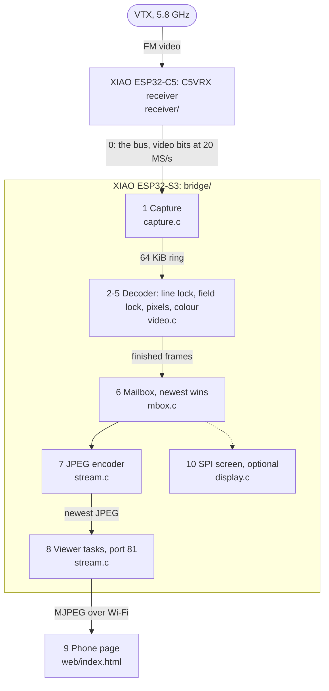
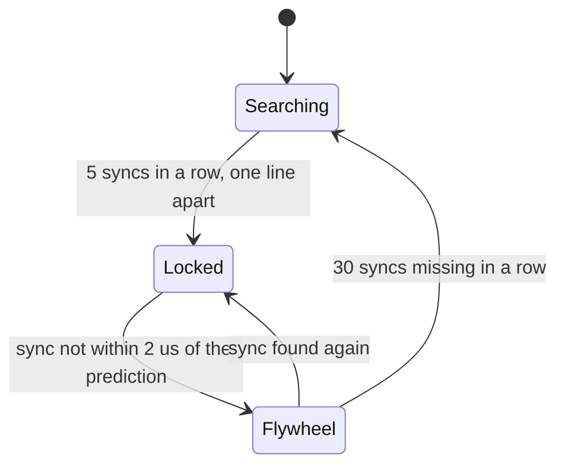
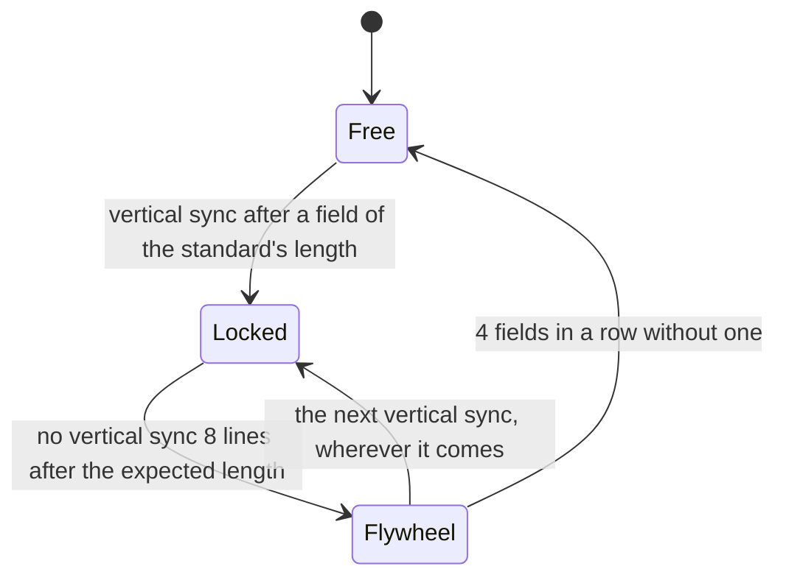
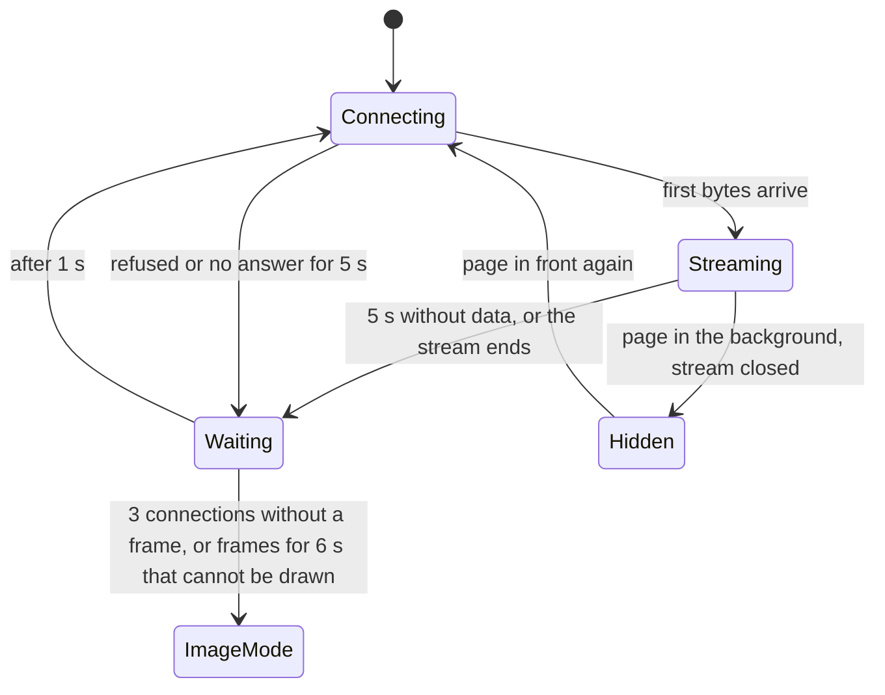
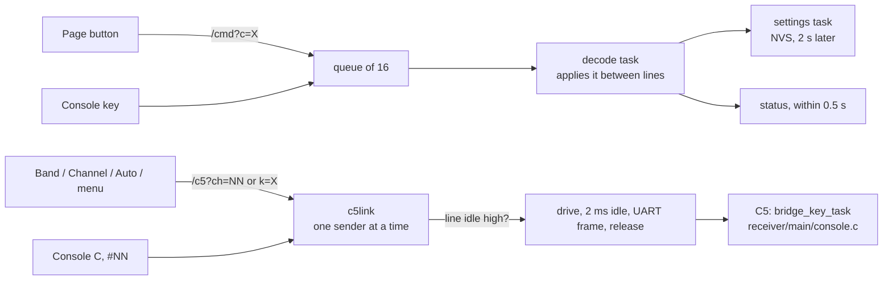

# ESP-VRX logic map

How the picture gets from the receiver to the phone, stage by stage: what
each stage does, what must always hold, how it fails, how it recovers and
where to look when it does not. The last section is the review that walked
this map through the code, with what it found.

Read it top to bottom to follow a frame, or jump to the stage that
misbehaves. File names are in `bridge/main/` unless they say otherwise.

- [1. The whole system](#1-the-whole-system)
- [2. Who runs where](#2-who-runs-where)
- [3. The picture path](#3-the-picture-path)
- [4. The control path](#4-the-control-path)
- [5. Shared data and what guards it](#5-shared-data-and-what-guards-it)
- [6. Time budget and delay](#6-time-budget-and-delay)
- [7. Review walk](#7-review-walk)

## 1. The whole system

The numbers are the stages of [section 3](#3-the-picture-path); the dotted
arrow is the optional screen. Commands travel the other way, from the page
(port 80) or the USB console to the decoder and, over the key link, to the
receiver: [section 4](#4-the-control-path).

## 2. Who runs where

Core 1 belongs to the decoder. Everything else runs on core 0.

| Task | Core | Priority | Wakes on | Does |
| --- | --- | --- | --- | --- |
| `decode` | 1 | 22 | every DMA node (0.1 ms), or 1 ms | decodes lines, applies picture commands, raw recordings |
| end-of-node interrupt | 0 | interrupt | every 2048 samples | counts ring nodes, wakes `decode` |
| Wi-Fi, lwIP, timer | 0 | 18 to 23 | system | the radio and network stack |
| `viewer` (up to 3) | 0 | 6 | a new JPEG, or 2 s | sends one JPEG per wake-up |
| page server (port 80) | 0 | 5 | a request | page, `/status`, `/cmd`, `/c5`, snapshot, icon |
| stream server (port 81) | 0 | 5 | a request | accepts `/stream`, starts a `viewer` |
| `display` (optional) | 0 | 4 | a new frame | SPI screen |
| `usbvid` (on demand) | 0 | 4 | a new JPEG | JPEG frames over USB |
| `console` | 0 | 3 | a key | status, dumps, self-tests |
| `jpeg` | 0 | 2 | a new frame | denoise, JPEG, publish |
| `settings` | 0 | 1 | a changed setting | writes NVS 2 s after the last change |

The encoder has the lowest working priority on purpose: with a noisy picture
it runs back to back, and must only get what the network and the console
leave.

| Memory | Size | Where | Why there |
| --- | --- | --- | --- |
| capture ring | 64 KiB | internal, DMA | written at 20 MB/s; 3.3 ms of signal |
| frame buffers | 3 x 180 KiB (4 with the screen) | PSRAM | luma rows plus a chroma plane |
| denoise running picture | 180 KiB | PSRAM | read and written by the encoder only |
| JPEG slots | 2 x 96 KiB | PSRAM | published and next |
| viewer buffer | 96 KiB each | PSRAM | a private copy to send from |
| colour band | 10 KiB | internal | 16 rows of YCbYCr for the block encoder |
| screen strips | 2 x 7.5 KiB | internal, DMA | one converted while the other is sent |

## 3. The picture path

### Stage 0: the bus (C5 to S3)

- **Does**: C5VRX puts its composite video out as 6-bit DAC codes at 20 MS/s,
  each held for 50 ns. With the keys on the bit 0 wire, bit 0 is always 0
  (5-bit video). The codes only use 24 levels; sync tip and blanking are
  about 6 codes apart, with about 2 codes of noise.
- **Must hold**: the five (or six) data wires in bit order, ground shared, the
  C5 running.
- **Fails**: the C5 hangs at power-up (bus stuck at one code: `sync=0.0
  blank=1.0` in `s`); two wires swapped (banded picture).
- **Recovers**: the C5's RESET button. Nothing in software.
- **Look**: `bridge_tool.py raw` (waveform, histogram, stacked lines).

### Stage 1: capture (`capture.c`)

- **Does**: the LCD_CAM camera port samples the pins on its own clock (looped
  out and back through GPIO42) and GDMA writes them into a ring of 32 nodes
  of 2048 bytes. An interrupt per finished node counts nodes and wakes the
  decoder. The write position is `nodes x 2048`, a 32-bit count that wraps
  every 215 s at 20 MS/s: every user works with differences.
- **Must hold**:
  - start, stop and the console's tests never overlap (one recursive mutex);
  - the write position only moves forward within one run, and every restart
    changes the *generation*, on which the decoder starts over;
  - a node interrupt held off for a ring or more still counts the rings that
    went by (`capture_nodes.h` compares the node index with the time).
- **Fails**: the port records nothing after a start (a missed VSYNC edge).
- **Recovers**: a second VSYNC edge; if that fails, the decoder retries the
  start every 2 s. Meanwhile the page says `CAPTURE FAULT`.
- **Look**: `s`: `capture=`, `rate=` (must read the configured MS/s); `L`
  self-test with nothing on the pins; `G` diagnostics.

### Stage 2: line lock (`video.c`, `process_line`)

Falling a ring behind does not change the state: locked (or on the
flywheel), whole lines are skipped and counted as an *overrun*; searching,
the search continues further on and counts a *catch-up*.

- **Does**: finds each line's sync edge on the signal averaged over 0.4 us
  (the C5's sync is too small and noisy for single samples), to 1/256 of a
  sample. Locked, it corrects half the phase error and 1/32 of the period
  error per line; the period stays within 62 to 65.5 us.
- **Must hold**: the decoder stays between 1/8 and 7/8 of a ring behind the
  write head (not into samples still being written, not into overwritten
  ones); only lines that began with a real sync update the levels.
- **Fails**: weak signal (syncs missing), or the decoder held off for more
  than about 2.9 ms.
- **Recovers**: flywheel for up to 30 lines, then a new search. A ring behind
  while locked: whole lines are skipped, both locks and the line count stay.
- **Look**: `s`: `h_lock`, `lock_losses`, `overruns` (picture lines lost),
  `catchups` (fell behind while searching: nothing lost), `line_us`,
  `line_max`.

### Stage 3: field lock (`video.c`, `field_start`)

Locked, a vertical sync counts when it comes within 8 lines of the expected
field length. Free, with no sync at all, a field ends every 400 lines, so
frames keep coming (snow, like an analog monitor).

- **Does**: a vertical sync is a run of at least 2 lines whose first half is
  low on 5 of 7 probes. NTSC or PAL follows from the lines per field, after 3
  fields agree. One field becomes one frame: 320x240 (NTSC) or 320x288 (PAL).
- **Must hold**: a forced field keeps the line phase (it takes the length of
  the field two back, so interlace 262/263 survives) and the next real sync is
  always taken; a vertical sync far too early is ignored while locked.
- **Fails**: fades and channel changes (missed syncs); dark picture mistaken
  for sync when the sync amplitude is tiny.
- **Recovers**: as in the diagram. A line-lock loss does not drop the field
  lock.
- **Look**: `s`: `v_lock`, `lines/field` (262/263 or 312/313), `fields`.

### Stage 4: levels and pixels (`video.c`, `render_line`, `update_mapping`)

- **Does**: sync tip and back porch are averaged per line (1/16 per line);
  the slicer sits halfway. Each of the 320 pixels is a median of three
  samples 0.1 us apart (despeckle) or a `[1 2 1]` low-pass. A table rebuilt
  per field maps levels to 0..255: *auto* stretches the 1st to 99.5th
  percentile of the field (smoothed, 1/4 per field), *std* puts black at
  blanking and white 100 IRE above.
- **Must hold**: rows are built in internal RAM and copied to the frame in
  one go (PSRAM is slow); only fields that will be shown are drawn.
- **Look**: `s`: `sync=`, `blank=`, `map=`, `levels=`, `filter=`, `line_us
  drawn=` (must stay under about 70 us).

### Stage 5: colour (`video.c`, `colour_burst`, `render_chroma`, `chroma_pie.S`)

A field is drawn in colour only if **all** of these hold, decided at the
field's start:

| Condition | On | Off | `s` shows |
| --- | --- | --- | --- |
| colour switched on | the Colour button, `m` | | `colour=off` |
| standard | NTSC | PAL | `colour=no-burst` |
| burst strength | above 0.8 codes | below 0.5 codes | `burst=` |
| burst phase noise | below 25 degrees | 30 degrees or more | `bnoise=`, `colour=noisy` |
| bursts measured in the last field | 16 or more | fewer (no line lock) | |
| levels known | sync 2 codes under blanking | | |

Between 15 and 30 degrees of noise the saturation fades (`sat=`), so a weak
picture loses its colour gradually instead of breaking into coloured
speckle.

- **Does**: the burst of every other line is measured against the subcarrier
  at the absolute sample index and averaged into a phase and amplitude
  reference. A burst more than 35 degrees off is used for its own line only;
  a second one off to the same side is a clock slip (the S3 and C5 clocks
  drift by a sample every few tens of ms) and restarts the average. Chroma is
  summed over 64 blocks per line (SIMD) and rotated into a Cb/Cr plane.
- **Look**: `s`: `colour=`, `burst=`, `bnoise=`, `sat=`, `slips=`, `clock=`.
  Full detail: [colour-study.md](colour-study.md).

### Stage 6: pacing and hand-off (`main.c` `on_field`, `mbox.c`)

- **Does**: at most `BRIDGE_MAX_FPS` frames a second go on, always from the
  same field parity (no bobbing); fields that would be dropped are not drawn.
  The mailbox holds 3 buffers (4 with the screen): the decoder's, the newest
  finished one, and one per reader. Each frame carries the time it was
  finished.
- **Must hold**: the decoder always gets a buffer back and never one a reader
  holds; the newest frame wins; a reader gets each frame at most once.
- **Look**: the host test runs 200,000 random hand-offs against these rules.

### Stage 7: encoder (`stream.c` `encoder_task`, `denoise.c`)

- **Does**: takes the newest frame, runs the temporal denoise (a pixel within
  28 of the running picture is averaged in, a bigger change is motion),
  encodes JPEG (gray, or colour 4:2:0 from 16-row bands built in internal
  RAM), swaps it into the published slot and wakes the viewers. Then it gives
  the lower tasks one tick.
- **Must hold**: the published JPEG only changes under its mutex; the frame
  goes back to the mailbox as soon as it is read; a frame that fails to
  encode is dropped, logged (once a second at most) and does not starve the
  idle task.
- **Look**: `s`: `fps=`, `jpeg=` (bytes), `enc_ms=` (denoise + colour bands +
  JPEG), `pipe_ms=` (last decoded line to JPEG ready).

### Stage 8: servers (`stream.c`)

- **Does**: each viewer has its own task and connection on port 81. It sends
  the newest JPEG as one write when woken, resends the last one after 2 s of
  silence (keep-alive), and counts what it skipped. The page server on port
  80 answers one request at a time.
- **Must hold**: a viewer that stops reading is closed by the send timeout
  (5 s) and frees its slot; when all 3 slots are taken the oldest viewer
  makes room and the new one retries (503); a viewer task is never notified
  after it removed its handle.
- **Look**: `w`: per viewer `fps`, `skipped/s`, `send_ms`; the page server's
  request count, its slowest request, and `BUSY for N s in ...` if a handler
  hangs. `/bench` measures the bare Wi-Fi link.

### Stage 9: the phone page (`web/index.html`)

- **Does**: reads the stream itself, decodes only the newest JPEG and draws
  it on a canvas that feeds a `<video>` (for the iPhone's native full
  screen). `/status` is polled once a second.
- **Must hold**: one status request at a time, given up after 3 s; a picture
  without a new frame for 2.5 s is dimmed under "No video arriving" (a frozen
  frame must not look live); the pickers show what the bridge reports, not
  what was tapped.
- **Look**: the badge (`LIVE`, `NO SIGNAL`, `NO FIELD SYNC`, `CAPTURE FAULT`,
  `offline`), the overlay's fps (frames this device really drew), Settings >
  Details. `tools/mock_bridge.py` reproduces a frozen stream, a hung status
  and a missing receiver.

### Stage 10: the wired screen (`display.c`, optional)

- **Does**: its own task takes the newest frame from the same mailbox and
  sends it as 20 strips of RGB565 over SPI; `NO SIGNAL` badge without lock,
  black after a second without frames.
- **Must hold**: neither the decoder nor the encoder ever waits for it.
- **Look**: `s`: `lcd_fps=`. Not yet run with a screen wired.

## 4. The control path

| Picture command | Does | Stored |
| --- | --- | --- |
| `t` | next source: C5, NTSC test pattern, PAL test pattern | no |
| `c` | levels auto / std | yes |
| `f` | despeckle median / smooth | yes |
| `d` | denoise on / off | yes |
| `m` | colour on / off | yes |
| `j` `l` `i` `k` | picture left / right / up / down | yes |
| `z` | all stored ones back to the defaults | erases |

- Picture commands only ever touch the decoder's state from the decoder's
  own task. Stored ones come back at the next start.
- **Receiver keys** (`o c b s n x v e`, and `<#NN>` for a channel) are only
  sent when the released key line sits high, which only a listening receiver
  makes it do. Otherwise nothing is driven and the page gets a 503. The S3
  never drives the line into an unpowered C5 or one that outputs video there.
- The receiver does not report back: the page shows the channel last set from
  the bridge, and "auto" after a scan. A channel picked during the C5's
  calibration is applied when that ends.

## 5. Shared data and what guards it

| Data | Written by | Read by | Guard |
| --- | --- | --- | --- |
| capture ring | DMA hardware | `decode` | position rules of stage 2 |
| node count | node interrupt | `decode`, console | one writer, 32-bit reads |
| decoder state (`video_t`) | `decode` | `decode` only | none needed: commands arrive by queue |
| decoder statistics | `decode`, every 0.5 s | servers, console, screen | spinlock |
| frame mailbox | `decode`, `jpeg`, `display` | the same | spinlock; buffers by ownership |
| published JPEG | `jpeg` | viewers, snapshot, console | mutex |
| viewer slots and handles | stream server, viewers | `jpeg` (wake-ups) | spinlock plus a mutex around notify and removal |
| denoise switch | any task | `jpeg` | request flag taken at the next frame |
| key line | page server, console | | mutex in `c5link.c` |
| capture start / stop | `decode`, console tests | | recursive mutex |
| settings to store | `decode` | `settings` | spinlock, then task notification |

A flash write (settings) stalls both cores for a few milliseconds, tens for
a sector erase. The decoder then finds itself behind and skips lines once;
the node count stays right because it also looks at the time. Settings are
therefore written 2 s after the last change, once.

## 6. Time budget and delay

| What | Time | Source |
| --- | --- | --- |
| one line | 63.56 us (NTSC), 64 us (PAL) | standard |
| decoding a drawn line | about 50 us gray, 62 us colour | board, `line_us drawn=` |
| what the ring holds | 3.28 ms at 20 MS/s | 65,536 samples |
| slack before an overrun | about 2.9 ms | 7/8 of the ring |
| one field | 16.68 ms (NTSC), 20 ms (PAL) | standard |
| frame interval at 30 fps | 33.4 ms (every other field) | `BRIDGE_MAX_FPS` |

The picture's delay from the camera to the eye is the sum of:

1. camera and VTX: not ours;
2. up to one field: the top row of a frame is 16 ms older than the bottom;
3. the decoder's lag behind the wire: under 1 ms;
4. **hand-off to JPEG ready: `pipe_ms` in `s`** (mean and longest of the last
   second), also under Settings > Details. Board, test pattern: 39 ms in
   colour, 29 ms in gray;
5. the send: `send_ms` per viewer in `w`;
6. the browser: decoding the JPEG and the next screen refresh.

Items 4 and 5 are measured by the bridge itself. The whole chain has not been
measured yet (it takes filming a stopwatch through the system).

## 7. Review walk

2026-11-12, firmware 1.0.0. Every stage above was read against its code and
its rules; the host tests and both firmware builds pass. **Fixed** means
changed in this pass; **open** means known and not solved.

Board check, 2026-11-13, the S3 alone (no receiver attached): the test
pattern locks in colour with 0 overruns; `pipe_ms` reads 39 ms in colour and
29 ms in gray; three setting changes are written as one save, with no
overrun from the flash write; after a restart the settings are back
(`picture settings: as stored`), and `z` restores the defaults. With a phone
on the page (test pattern, colour): the badge and buttons work, and the page
server answered 74 requests, the slowest in 6 ms. Not checked yet on the
board: a live signal and the receiver keys (the C5 was off).

| Stage | Finding | Status |
| --- | --- | --- |
| 1 capture | A node interrupt held off for a ring or more lost whole rings from the write position: the decoder took overwritten samples for fresh ones. Flash writes (now used for settings) make that a real case. | Fixed: the count also uses the time; host test over 3,572 cases |
| 2 line lock | `overruns` also counted falling behind while searching (204 during one receiver scan on the board), though nothing was lost. | Fixed: `overruns` (locked) and `catchups` (searching) |
| 2 line lock | Why the search falls behind during a receiver scan. Pure noise is fine: measured 10,384 lines/s against the 15,734 of a real signal. | Open: needs a raw recording taken during a scan |
| 2 decoder | The rate reading jumped for half a second after a command in test-pattern mode. | Fixed |
| 6 hand-off | Picture position, levels, despeckle, colour and denoise were lost at power-off. | Fixed: stored in NVS, `z` or Defaults resets |
| 6 hand-off | The bridge's own share of the delay was never measured. | Fixed: frames carry their time, `pipe_ms` |
| 7 encoder | The denoise switch was written by another task while the encoder used it: a stale running picture could be blended in once. | Fixed: request flag |
| 7 encoder | A frame that failed to encode was dropped silently, and repeated failures never yielded to the idle task. | Fixed: logged, yields |
| 7 encoder | Starting without the encoder task was not noticed. | Fixed |
| 8 servers | In a screenshot of 2026-10-26 the badge says `connecting` while the picture plays: no status request was answered for several seconds. The page server's handlers were checked (none blocks for long; the USB console cannot stall it for more than 50 ms). | Page side fixed (stage 9). Not seen again on 2026-11-13 (74 requests, slowest 6 ms). Cause still unknown: if it returns, `w` shows what the page server is doing |
| 8 servers | Browsers' icon requests got a 404 each (log noise, no home-screen icon). | Fixed: icon served |
| 8 servers | Left-over code erased a home network an early version stored. | Removed |
| 9 page | Status requests had no timeout and piled up one per second behind a hung one. | Fixed: one at a time, 3 s |
| 9 page | A frozen picture looked live. | Fixed: dimmed, "No video arriving" |
| 9 page | Toggle buttons had no state for screen readers, arrows no label; Test pattern sat under the receiver's menu; Levels did not show its state. | Fixed |
| 9 page | A status field missing in older firmware broke the whole details table. | Fixed: per row |
| control | The console's `C` reported a busy key line as "key not accepted". | Fixed: two messages |
| tools | `bridge_tool.py keys` hid every answer that did not start with `COMMAND` (the wire check, channel picks). | Fixed: prints all |
| tools | The USB live page could not switch colour. | Fixed |
| whole | No firmware version anywhere. | Fixed: `version.txt`, shown on the page, in `/status` and `s` |
| whole | Firmware, page and mock could drift apart unnoticed (status fields, commands, keys). | Fixed: `tools/check_consistency.py`, run with the host tests |
| docs | Stale references (a removed branch, the old filter, the home network, "Scan"), the screen described as gray only. | Fixed |

Still open, besides the two above:

- The whole camera-to-eye delay is not measured.
- The SPI screen has not run with a screen wired.
- Colour at 10 MS/s passes the host test but has not run on a board; PAL
  colour is not decoded.
- The node interrupt is delayed while flash is written (it is not
  cache-safe); the time-based count covers it, the decoder still loses those
  lines.
- The receiver does not report its channel back.
- Every unit has the same default network name and password.
